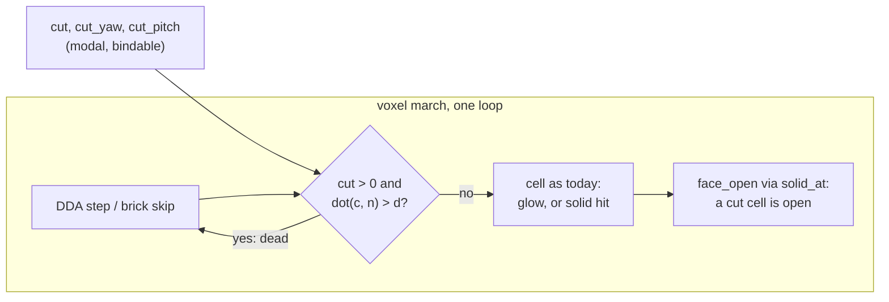

# 0258 — The voxel opens along a section plane

> **Status:** in-progress
> **Created:** 2026-10-11
> **Owner skill(s):** dev, human
> **Related ADRs:** [ADR-0271](../adrs/0271-a-voxel-is-opened-by-one-section-plane-held-in-the-cubes-own-frame.md) (proposed), [ADR-0268](../adrs/0268-a-3d-automaton-is-a-voxel-system-marched-as-an-emitting-absorbing-volume.md), [ADR-0269](../adrs/0269-a-solid-voxel-is-lit-by-one-key-light-and-its-own-occlusion-and-its-light-blooms-like-any-other.md), [ADR-0256](../adrs/0256-a-parameter-declares-its-group-and-whether-it-is-main.md)
> **Closes:** design-backlog 0288

## TL;DR

`voxel` gains three modal params, `cut`, `cut_yaw` and `cut_pitch`, that hide every cell beyond one
plane held in the cube's own frame. The march, the solid present's occlusion and the brick skip all
treat a cut cell as dead, so a dense rule shows its inside as a stepped section of cubes. At
`cut = 0` nothing moves. The first visible result is a `crystal` mass cut in half, turning, with its
hollows lit.

## Context & problem

Backlog 0288, from the owner's Plan 0256 Phase 5 verdict: the solid present is a keep, and the
owner wants to see holes inside the structure. The march stops at the first live cell, so a dense
rule shows only its skin. The teaching preset switched to the porous `pyroclastic` rule, which
changes the content rather than the view. The glow present has the same wall: its dense rules fill
their ball. ADR-0271 records the shape and the rejected alternatives.

## Decision

ADR-0271: one section plane. A cell whose centre `c` (in the cube's `[-1, 1]^3` frame) satisfies
`dot(c, n) > sqrt(3) * (1 - 2 * cut)` is dead to every reader, where `n` is the unit normal given by
`cut_yaw` and `cut_pitch` in the cube's frame. At `cut = 0` the test is skipped through a `select`.
We rejected a camera depth peel (the opening moves as the camera orbits), a clip box (six params for
one look), a structural key (no animation) and a capped section (hides the hollowness).

## Architecture diagram

## Implementation phases

### Phase 1 — Walking skeleton: one plane through the march
- **Owner skill:** dev
- **What:**
  - Add `cut` (`[0, 1]`, default 0), `cut_yaw` (`[0, TAU]`, default 0) and `cut_pitch`
    (`[-PI/2, PI/2]`, default 0) to `voxel/mod.rs`'s `PARAMS`, `ParamKind::Modal`, one group for all
    three, with only `cut` declared `main` (ADR-0256).
  - Pack the plane as one `vec4` (`n.xyz`, `d`) into the march uniforms, with `cut = 0` packing a
    flag that skips the test.
  - In `shader.rs`, one `cut_away(cell)` function. The march reads a cut cell as state 0 in both
    presents, and `solid_at` returns 0 for a cut cell, so `face_open` treats it as open.
  - The brick skip stays correct without learning the plane: a brick is skipped only on its own
    empty flag, and a full brick behind the plane is marched cell by cell.
  - One fixture: a solid 16³ block, `present = "solid"`, `ao = 0` (so no corner reads across the plane), `cut = 0.5`, `cut_yaw = 0`,
    `cut_pitch = 0`.
- **Files touched:** `core/src/render/scenes/voxel/mod.rs`, `core/src/render/scenes/voxel/shader.rs`,
  `core/src/render/scenes/voxel/tests.rs`, `core/tests/fixtures/`, and the generated
  `presets/README.md`, `presets/schema/`, `presets/preset.schema.json`, `.taplo.toml`,
  `docs/specs/player-schema.json`.
- **Done when:**
  - `cargo nextest run -p rlx-core --test golden` passes with `RLX_BLESS` unset, so `voxel.png` and
    `voxel_solid_ao.png` are byte-identical at `cut = 0`.
  - On the fixture, a test renders `cut = 0` and `cut = 0.5` with the eye **inside** the cut
    plane (the plane through the cube's centre contains the eye), so the plane projects to a
    straight line through the frame's centre. On the side the normal points to, every pixel has
    alpha 0 at `cut = 0.5`. On the other side, every pixel is byte-identical to the `cut = 0`
    render, because no ray on that side enters a cut cell.
  - At `cut = 1` the frame is the backdrop alone: every pixel's alpha is 0.

### Phase 2 — The section is lit as a surface
- **Owner skill:** dev
- **What:**
  - A test fixture holds a solid block with `ao = 1`, cut through the middle at
    `cut_pitch = 0.6`, so the section steps.
  - Confirm that the section's cell faces take the entry-face normal and the key light like any
    face, and that AO does not darken a section face against the cut cells beside it.
- **Files touched:** `core/src/render/scenes/voxel/tests.rs`, `core/tests/fixtures/`, and
  `core/src/render/scenes/voxel/shader.rs` only if the test finds a defect.
- **Done when:**
  - On a flat stretch of the section, a face's edge and its centre read the same value with
    `ao = 1`: no cut neighbour closes a corner.
  - The section's faces are interior to the block. At a pixel on the section, the `cut = 0` render
    reads the block's outer face, so the two renders differ there.

### Phase 3 — Cost, the golden, the teaching preset and the docs
- **Owner skill:** dev
- **What:**
  - Probe frame time on Plan 0255's three cost fixtures at `cut = 0` and `cut = 0.5`, same adapter,
    resolution and run (ADR-0074).
  - Bless one golden: the Phase 2 fixture at 32³, on the software adapter.
  - A second solid teaching preset, `docs/examples/voxel/section.toml`, runs a dense rule
    (`crystal` or `clouds`) with `cut` swept by an expression, and joins `scripts/docs-shots.mjs`
    as `docs/images/voxel/section.png`. It joins the `sanity`, `animation`, `reactivity` and
    `distinctness` rosters the way the solid teaching preset did in Plan 0256 Phase 3.
  - `docs/presets.md`'s `voxel` section documents the three params, that the cut turns with the
    structure and not the camera, and that the section is stepped at cell size.
  - The log carries the text for the preset-author skill's `## voxel` section, for Phase 4 (ADR-0210).
- **Files touched:** `core/tests/golden.rs`, `core/tests/golden/`, `core/tests/fixtures/`,
  `core/tests/sanity.rs`, `core/tests/animation.rs`, `core/tests/reactivity.rs`,
  `core/tests/distinctness.rs`, `docs/examples/voxel/section.toml`, `scripts/docs-shots.mjs`,
  `docs/images/voxel/section.png`, `docs/presets.md`, `presets/README.md`.
- **Done when:**
  - The log carries each fixture's frame time at both `cut` values. Any fixture where the cut run
    is slower than the uncut one is named with both times.
  - `cargo nextest run -p rlx-core --test golden` passes with `RLX_BLESS` unset.
  - The four gates pass with the section preset in their rosters.
  - `cargo nextest run -p rlx-core --test suite preset_schema::` passes with no update variable set.
  - `node scripts/check-doc-links.mjs` and `node scripts/toc.mjs --check` pass.

### Phase 4 — The owner's look and the skill text
- **Owner skill:** human
- **Blocks merge:** no
- **What:** Judge the section preset live. Apply the logged skill text to
  `.claude/skills/preset-author/`.
- **Files touched:** `.claude/skills/preset-author/`.
- **Done when:** The verdict is in this log, and the skill text is committed or declined.

## Risks & open questions

- **The brick skip is the cost risk.** A cut through a sparse field marches cut bricks cell by
  cell. If Phase 3's probe shows a named fixture slower than NFR section 1 on `Floor`, the follow-up
  is to fold the plane into the brick test (skip a brick wholly beyond the plane), which is a
  bounded change; it is not pre-built here.
- **The cut is in the cube's frame, and the camera orbits.** A sweep bound to `time` and an orbit
  bound to `time` can alias into a section that seems still. That is authoring, and the teaching
  preset is where it is shown.
- **The automaton keeps running under the cut.** Cells beyond the plane still live and still seed
  their neighbours. Only the view is cut, which is the point, and `docs/presets.md` says so.

## What this plan does NOT do

- It does not add a second plane, a box or a depth peel.
- It does not cap the section with a flat colour.
- It does not change the rules, the march's step or the lighting model.
- It does not retune `docs/examples/voxel/solid.toml`, which keeps `pyroclastic`.

## Implementation log

**Lane:** branch `plan-0258-the-voxel-opens-along-a-section-plane`, worktree `/home/igor/Work/rlx-plan-0258`

| phase | owner | state | commit |
|---|---|---|---|
| 1 — Walking skeleton: one plane through the march | dev | done | 2ae1af1c |
| 2 — The section is lit as a surface | dev | done | committed with this row |
| 3 — Cost, the golden, the teaching preset and the docs | dev | not started | |
| 4 — The owner's look and the skill text | human | not started | |

### Notes

- Phase 1: the plane's on/off flag rides in the unused `lit.w`, beside the new `cut` vec4.
  The fixture is `core/tests/fixtures/voxel_section.toml` (camera `yaw = pi/2`, so the eye
  lies in the plane). The probe's target is cleared transparent for this test, so "alpha
  0" reads the volume's own coverage; the existing probes still clear opaque black.
  `.taplo.toml` did not change on regeneration.
- Phase 2: the fixture is `core/tests/fixtures/voxel_section_lit.toml`, already at 32³, so
  Phase 3's golden reads the same file. The test's tread is chosen on the block's `+x` side,
  where a cut neighbour wrongly read as solid would close the corners unevenly; with
  `|| cut_away(c)` removed from `solid_at` it fails (edge 0.238 against centre 0.194).
  `shader.rs` was not changed.

### Close triggers

## Followups (after this lands)
