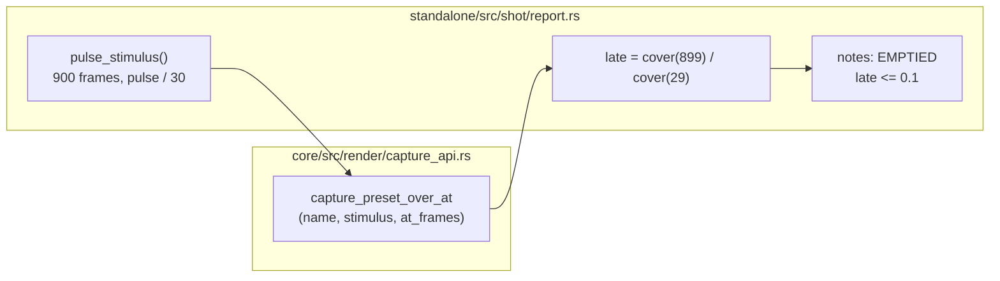

# 0261 — The report sees a world empty out

> **Status:** draft
> **Created:** 2026-10-11
> **Owner skill(s):** dev, human
> **Related ADRs:** [ADR-0099](../adrs/0099-the-show-length-horizon-is-a-spot-check-and-it-splits-in-two.md), [ADR-0196](../adrs/0196-the-report-hears-the-musical-clock-in-a-column-of-its-own.md)
> **Closes:** design-backlog 0294

## TL;DR

`shot --report` gains a `late` column. It is each preset's coverage after 15 seconds of a
music-like pulse, as a fraction of its coverage at half a second. A row whose `late` falls to a tenth
or less is flagged `EMPTIED` in the notes under the table. The first visible result is a sparse voxel
seed under `slow_decay`, which goes black today with every gate green, printing `EMPTIED` on the
first `--report` run against it.

## Context & problem

Backlog 0294. Authoring the voxel set, a sparse seed under `clouds` and `slow_decay` went black by
frame 300, and the author found it only by looking. Every instrument a preset passes measures its
first half second. The sanity suite captures 30 frames, the report's longest capture is 48, and
`--check` never runs the file. `shot --horizon` (ADR-0099) does measure minutes, but it is a manual
spot-check that the skill reserves for "worlds that accumulate", and it holds one `--set` for the
whole run. A held stimulus never re-fires an edge-triggered binding such as voxel's `reseed`, so a
horizon makes an onset-reseeded world look dead even when music keeps it alive.

So a world that empties out has no reading that runs by default, and the one long-run reading that
exists cannot tell "needs music" from "dies under music".

## Decision

Add one image-domain column to `--report`, for every system, measured under a pulsed stimulus rather
than a held one. Image-domain was the owner's choice over a voxel live-cell count (exact, but voxel
only and needing a new core readback) and over adding a suite gate (stronger, but it costs suite time
on every run). Like `count` and `drive`, the column is a reading, not a gate. The `EMPTIED` flag is
advisory and never changes the exit code.

The stimulus is 900 frames (15 s at the capture `dt`). Bands sit at a moderate level, and `onset`
and `beat` pulse for one frame every 30 frames (120 BPM), with the clock fields advancing as
`clock_stimulus` advances them. It is the cheapest sequence that keeps firing every edge a preset
can bind, so a world that empties out under it would empty out under music.

The capture reads back only two frames out of the 900. `capture_preset_at` holds one constant frame,
and `capture_preset_over` reads back every frame, so neither fits. Phase 1 adds the sibling that takes
a stimulus sequence and an index list.

## Architecture diagram

## Implementation phases

### Phase 1 — The capture primitive and the column
- **Owner skill:** dev
- **What:**
  - `Renderer::capture_preset_over_at(name, stimulus: &[AnalysisFrame], at_frames: &[usize])` in
    `capture_api.rs`. It advances one frame per stimulus entry from the same `reset_for_capture`
    seed as its siblings, and reads back only the listed indices, in `at_frames` order. It follows
    `capture_preset_at`'s rule for the readback buffer: built once, at the first requested frame.
  - `pulse_stimulus()` in `report.rs`, as described under Decision, with its constants named
    beside the existing `CLOCK_*` ones.
  - A `late` column. It reads `coverage(frame 899) / coverage(frame 29)` at `PROBE_SIZE`, each
    coverage taken against the frame-29 capture's own `modal_ground` with `COVERAGE_EPS`. A frame-29
    coverage of zero prints `-`. The JSON output carries the same field.
  - The notes block under each family table lists every row with `late <= 0.1` as
    `EMPTIED <preset> late=<value>`.
- **Files touched:** `core/src/render/capture_api.rs`, `core/tests/suite/capture_advance.rs`,
  `standalone/src/shot/report.rs`, `standalone/src/shot/report/tests.rs`,
  `standalone/src/shot/json.rs`.
- **Done when:**
  - A test in `capture_advance.rs` shows that `capture_preset_over_at(name, s, &[i])` is
    byte-identical to element `i` of `capture_preset_over(name, s)` for three indices, one of them
    the last.
  - A report test runs two inline voxel fixtures. One has a sparse seed under `slow_decay` and binds
    no `reseed`. The other is the same file with `reseed = "onset"`. The first is listed `EMPTIED`
    and the second is not.
  - The implementation log carries the `late` value of every shipped voxel preset, from
    `cargo run --release -p standalone --example shot -- --report family=voxel`.
  - The log carries the wall time of a whole-library `--report` before and after the change, on one
    adapter in one sitting.

### Phase 2 — The documentation and the skill text
- **Owner skill:** dev
- **What:**
  - `docs/capturing.md`, "What the report's columns mean", gains a `late` row in the table and a
    `#### The late column` section. The section covers the stimulus, the ratio, the tenth, and the
    two things the column cannot see. Coverage can hold while a world collapses into one bright
    blob, which is `--horizon`'s concentration reading. And a world can legitimately fade by design.
  - The "horizon" section of `docs/capturing.md` states that a held `--set` never re-fires an
    edge-triggered binding. Its example is voxel's `reseed`.
  - The `--report [family=<sys>]` row of the flag table lists every system the registry carries.
    It currently omits `voxel` and `waterfall`.
  - The log carries replacement text for the preset-author skill's `references/render-loop.md` for
    Phase 3 to apply, because a headless session cannot edit `.claude/` (ADR-0210). <!-- claude-allow: Phase 2 only logs replacement text for the preset-author skill and writes no file under .claude/; Phase 3 applies it -->
    The text covers two things. The horizon's trigger list ("run it when the mechanism has an
    accumulation axis") gains the cellular automata (`cellular`, `voxel`). And the report-reading
    section gains `late` and `EMPTIED`.
- **Files touched:** `docs/capturing.md`.
- **Done when:**
  - `git grep -c "EMPTIED" -- docs/capturing.md` prints a count of at least 1.
  - `git grep -n "family=<sys>" -- docs/capturing.md` shows a row naming both `voxel` and
    `waterfall`.
  - `node scripts/check-doc-links.mjs` and `node scripts/toc.mjs --check` pass.
  - The log carries the skill text.

### Phase 3 — The skill text
- **Owner skill:** human
- **Blocks merge:** no
- **What:** Apply the logged text to `.claude/skills/preset-author/references/render-loop.md`, or
  decline it.
- **Files touched:** `.claude/skills/preset-author/references/render-loop.md`.
- **Done when:** The text is committed or declined, and this log says which.

## Risks & open questions

- **The tenth is a choice, not a derivation.** It flags a world that has lost almost all of its
  light, which is what dying out looks like in this domain. A world that fades slowly by design will
  read low without being broken. That is why the flag is advisory and lives in the notes block, as
  `count`'s reading does.
- **Coverage is a proxy.** A world can keep its coverage while it dies, for example as a static
  residue that no longer moves. `anim` and `rate` already read motion, and `--horizon` reads the long
  run. This column answers "did it empty", not "is it alive".
- **Cost.** 900 frames at 96x96 per preset is the largest single capture the report takes. The
  horizon's measured rate (about 3,600 renders a simulated minute in 16 s at 96x96) puts it near 4 s
  per preset for a single-pass world. On a whole-library report that is minutes. Phase 1 logs the
  real figure. If it is unacceptable, the next lever is `family=`, which already exists, not a
  shorter stimulus, because shortening it gives back the half-second blind spot.

## What this plan does NOT do

- It does not add a suite gate. That was the third option, and the owner did not take it.
- It does not read voxel cells. The column is image-domain for every system.
- It does not change `--horizon` or its held stimulus.
- It does not retune any shipped preset that the column flags. That is the content lane's call, and
  Phase 1 only logs the voxel readings.

## Implementation log

**Lane:**

| phase | owner | state | commit |
|---|---|---|---|
| 1 — The capture primitive and the column | dev | not started | |
| 2 — The documentation and the skill text | dev | not started | |
| 3 — The skill text | human | not started | |

### Notes

### Close triggers

## Followups (after this lands)
