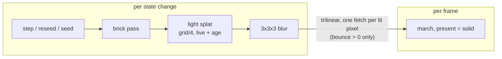

# 0263 — Solid voxels light each other

> **Status:** in-progress (2026-10-11)
> **Created:** 2026-10-11
> **Owner skill(s):** dev, human
> **Related ADRs:** [ADR-0272](../adrs/0272-a-solid-voxel-takes-light-from-its-neighbours-through-a-coarse-field-rebuilt-each-generation.md) (accepted), [ADR-0269](../adrs/0269-a-solid-voxel-is-lit-by-one-key-light-and-its-own-occlusion-and-its-light-blooms-like-any-other.md), [ADR-0268](../adrs/0268-a-3d-automaton-is-a-voxel-system-marched-as-an-emitting-absorbing-volume.md)
> **Closes:** design-backlog 0295

## TL;DR

`voxel` gains `bounce`, a modal parameter (default 0) that is read only under `present = "solid"`.
When it is non-zero, a coarse light field is rebuilt after every state change, and each solid face
adds the light of the cells in front of it. The first visible result is a fixture cell beside a block
of live cells, whose facing side brightens as `bounce` rises while the same cell alone does not.

## Context & problem

Backlog 0295. A solid voxel lights only itself, so Ember, Neon and Ice fake an inner glow with
`ambient = 0.75` and a heavy bloom over a `0.55` threshold. That halo spills in screen space. ADR-0272
has the mechanism and the rejected alternatives. It chose the per-generation field over a per-hit
gather because of per-frame cost, on a march whose live frame rate is still in question (backlog
0290).

## Decision

ADR-0272:

- The field is an `rgba16float` 3D texture of side `grid / 4`. A splat dispatch writes each texel's
  live fraction and mean age over its 4³ block. One 3³ blur dispatch writes a second texture, which
  the march samples trilinearly.
- The field is rebuilt wherever the brick pass is dispatched: after every frame that changed the
  state.
- The solid shade adds
  `bounce * palette(L.age) * L.intensity * brightness * shell(cell)`, with `L` sampled at
  `hit + n * half_cell`.
- At `bounce = 0` nothing is built and the fetch is skipped. The field is built lazily on the first
  frame with `bounce > 0`, and filled that same frame.

## Architecture diagram

## Implementation phases

### Phase 1 — Walking skeleton: one face lit by its neighbours
- **Owner skill:** dev
- **What:**
  - Add `bounce` to voxel's `PARAMS` through `solid_only!`, so the reference prints it as inert under
    `glow`. Its range is `[0, 2]`, `ParamKind::Modal`, the same group as `ambient`, not `main`. Its
    `set_param` arm and its roster rows in `core/tests/suite/preset.rs` go in with it.
  - Add the light field, its two compute pipelines and the shader entry points to `shader.rs`.
    Everything is built lazily on the first frame with `bounce > 0`. The dispatch follows the brick
    pass, and the first frame that builds the field also fills it, state change or not.
  - Add the march term, under a uniform flag that skips the fetch at `bounce = 0`.
  - Add a `light_builds` counter, readable by tests the way `builds` is on `trails` and `bloom`.
- **Files touched:** `core/src/render/scenes/voxel/mod.rs`, `core/src/render/scenes/voxel/shader.rs`,
  `core/src/render/scenes/voxel/tests.rs`, `core/tests/suite/preset.rs`, and the generated
  `presets/README.md`, `presets/schema/`, `presets/preset.schema.json`, `.taplo.toml`,
  `docs/specs/player-schema.json`.
- **Done when:**
  - `cargo nextest run -p rlx-core --test golden` passes with `RLX_BLESS` unset, so every voxel
    golden is byte-identical with `bounce` unbound.
  - A voxel test renders a solid fixture at `bounce = 0` across a run of generations and reads
    `light_builds == 0`.
  - A voxel test draws one live cell with a 4³ block of live cells three cells to one side, at
    `bounce = 0` and `bounce = 1`. The cell's face toward the block is brighter at 1 than at 0, and
    it gains more between 0 and 1 than the same face gains when the cell is drawn alone, without the
    block.
  - A test in which the field is first built mid-run reads the same frame as a run that had
    `bounce > 0` from the start, at the frame after the switch.
  - `cargo nextest run -p rlx-core --test suite preset_schema::` and
    `cargo nextest run -p rlx-core --test suite preset::the_parameter_reference_block_is_current`
    pass with no update variable set.

### Phase 2 — Cost, the golden and the documentation
- **Owner skill:** dev
- **What:**
  - Bless one golden: a solid fixture at `bounce = 1`, on the software adapter.
  - Measure `docs/examples/voxel/solid.toml` with `bounce = "1"` added and without it, at 1920x1080
    on `Floor` and on `Rich`, with `shot --report`'s frame-cost block, in one run on one adapter
    (ADR-0074). Log all four figures, and the per-generation cost of the two dispatches if the
    harness can separate it.
  - In `docs/presets.md`'s "The `[voxel]` table" section, document `bounce`.
    Cover what it reads, that it is solid-only, the leak through walls, the softness, the shell
    approximation (ADR-0272, Negative), and that it composes with bloom.
  - The log carries the text that the preset-author skill's voxel notes should gain, for Phase 3 to
    apply (ADR-0210). <!-- claude-allow: Phase 2 only logs replacement text for the preset-author skill and writes no file under .claude/; Phase 3 applies it -->
- **Files touched:** `core/tests/golden.rs`, `core/tests/golden/`, `docs/presets.md`.
- **Done when:**
  - `cargo nextest run -p rlx-core --test golden` passes with `RLX_BLESS` unset.
  - The log carries the four frame times. With `bounce` on, a frame costs no more than one extra
    texture fetch per lit pixel over the frame with it off, or the log names the difference.
  - `node scripts/check-doc-links.mjs` and `node scripts/toc.mjs --check` pass.

### Phase 3 — The owner's look and the skill text
- **Owner skill:** human
- **Blocks merge:** no
- **What:** Judge Voxel Ember live with `bounce` raised (and its bloom lowered to taste) against
  the shipped Ember. Apply the logged skill text to `.claude/skills/preset-author/`. Whether any
  shipped preset adopts `bounce` is content work for `preset-author` afterwards.
- **Files touched:** `.claude/skills/preset-author/`.
- **Done when:** The verdict is in this log, and the skill text is committed or declined.

## Risks & open questions

- **The leak may read as wrong rather than soft.** On a thin wall, light from behind shows through.
  Phase 3's look is where that is judged. If it fails, the next step is an occlusion term in the
  splat (weight a block's emission by its openness), which is a revision of ADR-0272, not a patch.
- **Cost on the live window.** Backlog 0290 says the live march can fall far below what `shot`
  measures. This plan adds little per frame, but Phase 2's figures are headless. A live reading
  belongs to 0290's repro, not here.
- **Reseed between generations.** A reseed stamp changes cells on a frame with no generation. The
  field must follow every pass that writes cells, which is why it is tied to the brick pass rather
  than to the generation clock. Phase 1's mid-run test covers the build path, and the brick pass's
  own trigger covers the rest.

## What this plan does NOT do

- It does not light the `glow` present, which already emits volumetrically.
- It does not add shadows, specular or occlusion to the bounce.
- It does not retune Ember, Neon or Ice. That is content work after the close, and Plan 0264 may
  pick it up.

## Implementation log

**Lane:** branch `plan-0263-solid-voxels-light-each-other`, worktree `/home/igor/Work/rlx-plan-0263`

| phase | owner | state | commit |
|---|---|---|---|
| 1 — Walking skeleton: one face lit by its neighbours | dev | done | 88a42bca |
| 2 — Cost, the golden and the documentation | dev | done | 9b33af60 |
| 3 — The owner's look and the skill text | human | owed | |

### Notes

- Phase 1: `core/tests/suite/preset.rs` needed no row. `bounce` is `Modal`, and the only voxel
  roster there is `STRUCTURAL`; `declared_params_match_set_param` reads the new arm from source.
  `.taplo.toml` did not move on regeneration.
- Phase 1: the bounce term also multiplies by `fog`, as the key and ambient terms do in the march.
  ADR-0272's formula does not name fog.
- Phase 1: the field is built and filled only under `present = "solid"`. Under `glow`, `bounce > 0`
  builds nothing, and `bounce_0_builds_no_light_field` asserts that.
- Phase 1: the splat does not read the section plane, so a cut cell still emits into the field.
- Phase 2: the `voxel_bounce` fixture is a TOML string constant in `core/tests/golden.rs`
  (`FIXTURES_VOXEL_BOUNCE`), not a file under `core/tests/fixtures/`, which is outside the phase's
  files. A porous 32³ ball, `bounce = 1`. It was blessed with `RLX_BLESS=1` because the stem was new.
  The bless rewrote `backdrop_ramp.png` and `backdrop_band.png`, and those two were restored. Both
  read mean 0.0005 against their committed baselines, within tolerance.
- Phase 2: cost, `shot --report` frame-cost block, 1920x1080, release, on `AMD Radeon Graphics
  (RADV RENOIR)` (integrated, Mesa 26.2.2). `shot` has no adapter flag, so this is the adapter it
  picks, not the box's discrete GPU (ADR-0243). Each tier was one `--report` invocation over a
  directory holding both presets (`docs/examples/voxel/solid.toml` with and without `bounce = "1"`).
  ms/frame: Floor, off 5.981 and on 4.834. Rich, off 4.186 and on 4.032. In both pairs the frame
  with `bounce` on read cheaper, which is inside the harness's noise. The harness cannot separate
  the two per-generation dispatches from the frame. These figures therefore leave the per-frame
  cost of `bounce` unresolved, rather than showing it within one extra fetch per lit pixel; a live
  reading belongs to backlog 0290's repro, as the Risks section says.
- Phase 2, the text for Phase 3: insert this into `.claude/skills/preset-author/references/systems.md`
  after the **Solid** paragraph's last sentence ("Low `trail` (0.1-0.3) keeps the decay haze from
  washing out the faces."), before **The section plane.**:

  > **Bounce.** `bounce` (0-2, solid-only, default 0) lets a face take the light of the live cells
  > in front of it, so a structure glows onto itself instead of through a screen-space halo. Start at
  > 0.5-1 and lower `bloom_amount` to match: the glow then stays inside the structure and off the
  > background. It is soft (blocks of 4 cells, reaching about 6) and has no occlusion, so light shows
  > through thin walls and reads as translucency there. It is coloured at the neighbours' mean age, so `age_tint` tints it. It costs nothing
  > at 0, and on is refilled per generation, not per frame.

### Close triggers

- `presets/` touched: `presets/README.md`, `presets/preset.schema.json`,
  `presets/schema/voxel.schema.json` (generated, the `bounce` row). No preset `.toml`.
- Closes: design-backlog 0295.
- Shipped: feature (a new voxel param, `bounce`).
- Operator docs moved: `docs/presets.md` (a `bounce` section under the `[voxel]` table),
  `presets/README.md` (generated reference row), `docs/specs/player-schema.json` (generated).
- `node scripts/check-backlog-claims.mjs`: exit 0, 48 reductions hold across 23 live entries.
- `human` phases remaining: Phase 3 (`Blocks merge: no`).
- Full suite: owed to the conductor's pre-review gate (ADR-0207). Run at the phases:
  `cargo nextest run -p rlx-core --test golden --test suite` at Phase 1, exit 0, 333 passed and 1
  skipped; `cargo nextest run -p rlx-core --test golden` at Phase 2, exit 0, 5 passed; the voxel
  unit tests (`--lib scenes::voxel`) at Phase 1, exit 0, 25 passed.

## Followups (after this lands)
