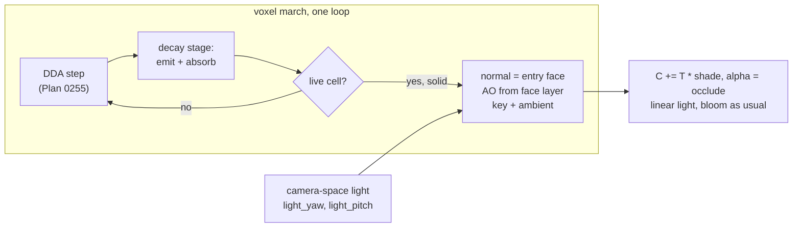

# 0256 — The voxels turn solid

> **Status:** done - Phases 5 and 6 owed, ADR-0249. Closed 2026-10-11 by a conductor close, round 1:
> Phases 1-4 in 13569903, 1ae668d1, d7165bbd and 3b7f4d6c; review **no blockers, no majors, four
> minors (three fixed), one nit (fixed)**; full suite green on the reviewed tree; v0.173.0.
> **Created:** 2026-10-08
> **Owner skill(s):** dev, human
> **Related ADRs:** [ADR-0269](../../adrs/0269-a-solid-voxel-is-lit-by-one-key-light-and-its-own-occlusion-and-its-light-blooms-like-any-other.md) (accepted), [ADR-0268](../../adrs/0268-a-3d-automaton-is-a-voxel-system-marched-as-an-emitting-absorbing-volume.md) (accepted), [ADR-0046](../../adrs/0046-linear-light-hdr-composite-bloom-tonemap.md), [ADR-0201](../../adrs/0201-a-fullscreen-scene-presents-premultiplied-over-the-backdrop.md)
> **Depends on:** [Plan 0255](0255-the-voxel-automaton-glows.md) closed. This plan extends its march, so it runs only after 0255 closes.

## TL;DR

`voxel` gains `present = "solid"`. The same march that draws Plan 0255's glowing volume stops at the
first live cell, and lights that cell's face:

- **Normal:** the face the ray entered, exact from the grid traversal.
- **Light:** one key light in camera space plus an ambient term.
- **Occlusion:** per-corner voxel AO that darkens every crease.

The decay stages in front of the surface still glow. The first visible result is a lit, faceted
structure turning in the camera, with no new pass and no depth buffer.

## Context & problem

Plan 0255 draws a 3D automaton as an emitting, absorbing volume. The owner asked for solid lit cubes
next. Unlit solid cubes are a flat silhouette, so this is the engine's first non-emissive register.
ADR-0269 records the lighting model, why it is camera-space, why the occlusion is voxel AO rather
than a screen-space estimate, and its answer to backlog 0092's open question: a lit surface blooms
like any other light.

## Decision

A structural `present = "glow" | "solid"` on `[voxel]`, with `glow` the default and byte-identical.
Under `solid`:

- **The march.** It accumulates decay-stage emission and absorption as `glow` does, and terminates
  at the first live cell.
- **The shade.** `palette(age) * brightness * shell * (ambient * ao + key * max(0, n . l))`,
  composited under the light gathered so far, with `alpha = occlude` at a hit.
- **The light.** Its direction comes from `light_yaw` and `light_pitch` in camera space.
- **The occlusion.** `ao` mixes in the per-corner occlusion interpolated across the face.

We rejected instanced cube meshes with a depth buffer, a matcap, and a bloom exemption for lit light
(ADR-0269, Alternatives).

## Architecture diagram



## Implementation phases

### Phase 1 — Walking skeleton: the march stops and lights the face
- **Owner skill:** dev
- **What:**
  - Add `present` to `[voxel]`, structural, `glow` by default.
  - Under `solid`, the march terminates at the first live cell and takes the normal from the last
    stepped axis.
  - Shade with the key light and ambient, AO not yet applied.
  - Add the modal params `key`, `ambient`, `light_yaw`, `light_pitch`, each with its `group` and
    `main` (ADR-0256), and declare them inert under `glow` (ADR-0180 rule 4).
  - Add a solid teaching preset under `docs/examples/voxel/`.
- **Files touched:** `core/src/render/scenes/voxel/mod.rs`, `core/src/render/scenes/voxel/shader.rs`,
  `core/src/render/scenes/voxel/tests.rs`, `core/src/preset/schema/raw/voxel.rs`,
  `core/src/preset/schema/load.rs`, `core/tests/fixtures/`, `docs/examples/voxel/`,
  `scripts/docs-shots.mjs`, and the generated `presets/README.md`, `presets/schema/`,
  `presets/preset.schema.json`, `.taplo.toml`, `docs/specs/player-schema.json`.
- **Done when:**
  - `cargo nextest run -p rlx-core --test golden` passes with `RLX_BLESS` unset, so every `glow`
    golden is byte-identical.
  - On a fixture holding one solid 8³ block seen from `yaw = 0.6, pitch = 0.4`, `shot` shows three
    faces at three distinct brightnesses. A test reads the three face centres and finds them
    ordered by `n . l`.
  - With `key = 0` and `ambient = 1`, the three face centres read the same colour, the albedo.

### Phase 2 — Voxel ambient occlusion
- **Owner skill:** dev
- **What:**
  - At a hit, read the occupancy of the cells around the hit face's four corners in the layer the
    ray came from. The classic three-neighbour rule gives each corner 0-3 occluders.
  - Interpolate across the face at the hit point and mix in by `ao` (0 = none).
  - Add a fixture whose structure has an inner corner (an L of two blocks).
- **Files touched:** `core/src/render/scenes/voxel/mod.rs`, `core/src/render/scenes/voxel/shader.rs`,
  `core/src/render/scenes/voxel/tests.rs`, `core/tests/fixtures/`.
- **Done when:**
  - With `ao = 0` the Phase 1 fixtures render byte-identical to Phase 1.
  - With `ao = 1` on the L fixture, the face next to the inner edge reads strictly darker at the
    edge than at its own centre, and a face with no neighbours reads the same at its edge and
    centre.

### Phase 3 — Cost, the golden and the gates
- **Owner skill:** dev
- **What:**
  - Probe `solid` on Plan 0255's three cost fixtures, with `present = "solid"`, on the same adapter,
    resolution and profile as Plan 0255 Phase 3, against `glow` in the same run (ADR-0074).
  - Add a golden for the L fixture at 32³ with AO on, blessed on the software adapter.
  - Add the solid teaching preset to the `sanity`, `animation`, `reactivity` and `distinctness`
    rosters.
- **Files touched:** `core/tests/golden.rs`, `core/tests/golden/`, `core/tests/fixtures/`,
  `core/tests/sanity.rs`, `core/tests/animation.rs`, `core/tests/reactivity.rs`,
  `core/tests/distinctness.rs`, `core/src/render/scenes/voxel/tests.rs`.
- **Done when:**
  - The log carries each fixture's `solid` and `glow` frame times. Each `solid` time on `Floor` is
    inside NFR section 1. The expectation is that `solid` is no slower than `glow` on the same
    fixture, because it terminates earlier. A fixture where it is slower is named, with both times.
  - `cargo nextest run -p rlx-core --test golden` passes with `RLX_BLESS` unset.
  - The four gates pass with the solid preset in their rosters.

### Phase 4 — Documentation and the references
- **Owner skill:** dev
- **What:**
  - `docs/presets.md` gains `present` and the four light params. It states that a lit surface
    blooms like any light, and that `trails` smear shading as if it were light (ADR-0269,
    Negative).
  - The generated files are regenerated.
  - `docs/preset-guide.md` gets the solid picture.
  - The log carries the text the preset-author `## voxel` section gains, for the owner to apply in
    Phase 6: working ranges for `key`, `ambient` and `ao`, and the note that bloom on a solid preset
    is a choice made through `brightness`. A headless session cannot edit `.claude/` (ADR-0210).
  - Backlog 0092 gains a dated bullet: ADR-0269 answers its bloom question for `voxel`, and its own
    ask (a matcap on the shape field) stays open.
- **Files touched:** `docs/presets.md`, `presets/README.md`, `presets/schema/`, `.taplo.toml`,
  `docs/preset-guide.md`, `docs/images/`, `docs/design-backlog.md`.
- **Done when:**
  - `cargo nextest run -p rlx-core --test suite preset_schema::` passes with no update variable set.
  - `cargo nextest run -p rlx-core --test suite the_parameter_reference_block_is_current` passes.
  - `node scripts/toc.mjs --check`, `node scripts/check-doc-links.mjs`,
    `node scripts/check-reader-prose.mjs` and `node scripts/check-backlog-claims.mjs` pass.

### Phase 5 — The look, judged
- **Owner skill:** human
- **Blocks merge:** no
- **What:** the owner runs the solid teaching preset live with the music track, on `Floor` and
  `Rich`. They judge:
  - whether the structure reads as solid cubes with creases;
  - whether the camera-space light reads well through an orbit;
  - whether the glowing decay haze in front of the surface helps or muddies.
  Then they hand a brief to `preset-author`.
- **Files touched:** none.
- **Done when:** the owner records a keep, or a list of what is off, in this plan's log.

### Phase 6 — The preset-author reference
- **Owner skill:** human
- **Blocks merge:** no
- **What:** the owner applies, in an interactive session, the text Phase 4 left in the log to
  `.claude/skills/preset-author/references/systems.md`'s `## voxel` section.
- **Files touched:** `.claude/skills/preset-author/references/systems.md`.
- **Done when:** the edit is committed on `main` and `node scripts/check-doc-links.mjs` exits 0.

## Data shapes

```rust
// illustrative, not the final interface
pub enum Present { Glow, Solid }      // [voxel] present, structural
// Added to the march uniform under Solid:
//   light_dir: [f32; 3]   camera space, from light_yaw / light_pitch, rotated to world on the CPU
//   key: f32, ambient: f32, ao: f32
```

## Risks & open questions

- **The decay haze may muddy the surface.** On a rule with many decay stages, the haze in front of a
  lit face can wash it out. `density` and `trail` control it. If the judging in Phase 5 says it
  muddies, a later change can make the haze opt-out under `solid`, which this plan does not pre-empt.
- **The grid shows on the faces.** At 64³ on `Floor` the cubes are large and the march target is
  scaled down, so face edges may alias. A one-texel edge darkening from the AO interpolation may
  hide it. Phase 3's golden is where it shows first.
- **Trails smear shading.** A solid preset with `trails` on drags dark faces as if they were dim
  light (ADR-0269, Negative). The documentation says so, and nothing prevents it.
- **No shadows.** Cast shadows are the next thing a solid structure asks for. A shadow ray is a
  second march per pixel, roughly doubling the worst case. That is a followup with its own cost
  probe, not a phase here.

## What this plan does NOT do

- Cast shadows, add specular, or add a world-fixed light.
- Light anything outside `voxel` (backlog 0092's shape-field matcap stays its own decision).
- Add a depth buffer or mesh any cell.
- Ship presets. That belongs to `preset-author` after Phase 5.

## Implementation log

**Lane:** branch `plan-0256-the-voxels-turn-solid`, worktree `/home/igor/Work/rlx-plan-0256`

| phase | owner | state | commit |
|---|---|---|---|
| 1 — Walking skeleton: the march stops and lights the face | dev | done | 13569903 |
| 2 — Voxel ambient occlusion | dev | done | 1ae668d1 |
| 3 — Cost, the golden and the gates | dev | done | d7165bbd |
| 4 — Documentation and the references | dev | done | 3b7f4d6c |
| 5 — The look, judged | human | owed | |
| 6 — The preset-author reference | human | done | committed with this row |

### Notes

- Phase 1: `[voxel]` cannot express an 8³ block (the seed is a ball). The done-when tests in
  `voxel/tests.rs` write the 8³ block into the state texture directly, which adds `COPY_DST` to the
  state textures' usage. The `shot` fixture `core/tests/fixtures/voxel_solid_block.toml` is the whole
  16³ grid filled, a 16³ block.
- Phase 1: files outside the phase's list, needed to declare `present` as a roster key and the light
  params as inert under `glow`: `core/src/preset/schema/export.rs` (`Roster::VoxelPresent`),
  `core/src/preset/schema/tests.rs` (its roster check), `core/src/render/scenes/mod.rs`
  (`family_params("voxel")`), `core/src/render/mod.rs` (`active_family_key` answers the present).
  `core/src/preset/schema/load.rs` and `.taplo.toml` did not change.
- Phase 1: the shade is also multiplied by the camera's `fog`, as a glowing cell's light is; the
  ADR's formula does not name it.
- Phase 2: the `ao` param (default 1) is declared here, so this phase also regenerated
  `presets/README.md`, `presets/schema/`, `presets/preset.schema.json` and
  `docs/specs/player-schema.json`, outside its file list.
- Phase 2: the L of two blocks is written into the state texture by
  `ambient_occlusion_darkens_the_inner_edge_of_an_l`, as Phase 1's block is; the TOML fixture
  `core/tests/fixtures/voxel_solid_ao.toml` is a solid ball on a 32³ grid, whose terraces carry the
  inner edges, because `[voxel]` cannot seed an L.
- Phase 2: "with `ao = 0` the Phase 1 fixtures render byte-identical to Phase 1" was checked with
  `shot` (640x360) of `voxel_solid_block.toml` and `docs/examples/voxel/solid.toml`, captured at
  Phase 1's commit and again here with `ao = "0"` added to a scratch copy: `cmp` found both pairs
  identical. No test holds it.
- Phase 3 probes, `shot --presets <scratch dir> --report`, release, 1920x1080, tier `Floor`, AMD
  Radeon Graphics (RADV RENOIR), Mesa 26.2.2; Plan 0255's three cost fixtures copied into one
  directory as a `glow` and a `present = "solid"` twin each, all six in one run. ms a frame,
  `glow` / `solid`: sparse 10.591 / 8.228; cloudy 15.293 / 4.781; worst 16.813 / 11.199. Every
  `solid` reading is under 16.67 ms and none is slower than its `glow` twin. The `glow` readings
  are higher than Plan 0255 Phase 3's 6.23 / 11.68 / 12.70 on the same adapter; the worst `glow`
  twin reads past 16.67 ms in this run. The solid twins were not committed as fixtures.
- Phase 3 golden: `voxel_solid_ao` is `core/tests/fixtures/voxel_solid_ao.toml` (the 32³ solid
  ball, AO on), not an L. It was first written with `RLX_BLESS=1`, the harness refusing a stem with
  no PNG; the two baselines that run re-encoded, `backdrop_band.png` and `backdrop_ramp.png`, were
  restored with `git restore`.
- Phase 3 gates: `voxel` ships no preset, so the four rosters hold the solid teaching preset
  `docs/examples/voxel/solid.toml` through one dedicated test each in `sanity`, `animation`,
  `reactivity`, and a `distinctness` test printing it against `docs/examples/voxel/clouds.toml`.
  The teaching preset gained `reseed = "onset"` and `key = "0.4 + 1.6 * bass"` to clear the
  reactivity floor: a first `0.8 + 0.6 * bass` read bass 0.0160 against 0.02. Readings: sanity
  coverage 0.2016, 4 quadrants, flatness 0.3089, boundary 0.0753; animation silent 0.0314, driven
  0.0903, silent branch; reactivity bass 0.0275, onset 0.0200; distinctness against `clouds` shape
  0.232, pixel 0.126. Only these voxel tests of the four gates were run here.
- Phase 4: the generated files were already current from Phases 1 and 2 (both tests pass with no
  update variable set), so nothing was regenerated. The guide's picture is
  `docs/images/voxel/solid.png`, rendered by the `scripts/docs-shots.mjs` entry Phase 1 added.
- **For Phase 6**, the text for `.claude/skills/preset-author/references/systems.md`. That file has
  no `## voxel` section yet (Plan 0255's Phase 7 is still owed), so this goes at the end of the one
  that phase adds:

  > **Solid.** `[voxel] present = "solid"` draws each live cell as a lit cube; the decay stages in
  > front still glow. Five params, inert under `glow`: `key` (the key light, working range 0.4-1.6;
  > bind the bass here for a pulse), `ambient` (0.15-0.4; 1 with `key = 0` shows the palette flat),
  > `ao` (0.6-1; it darkens the creases where cubes meet, which is what makes a cluster read as
  > structure, and at 0 the faces go flat), and `light_yaw` / `light_pitch`, given relative to the
  > camera, so the lit side stays lit through an orbit (`-0.6, 0.6` lights from the upper left).
  > **Bloom on a solid preset is a choice made through `brightness`:** a lit face blooms like any
  > light, so keep `brightness × (ambient + key)` under the bloom threshold for crisp cubes and push
  > past it only for a glowing core. Keep `trails` off: it smears the dark faces as if they were dim
  > light. Low `trail` (0.1-0.3) keeps the decay haze from washing out the faces.

### Close triggers

- **`presets/` touched:** generated files only: `presets/README.md` (the params block),
  `presets/preset.schema.json` and `presets/schema/*.schema.json`. No `.toml` preset.
- **`Closes:`** the plan header names none.
- **What shipped:** a feature (`[voxel] present = "solid"`, five new `voxel` params).
- **Operator docs moved:** `docs/presets.md`, `docs/preset-guide.md` (and `docs/images/voxel/solid.png`),
  `docs/design-backlog.md` (0092), `docs/specs/player-schema.json` (generated), new teaching preset
  `docs/examples/voxel/solid.toml`.
- **`node scripts/check-backlog-claims.mjs`:** exit 0; no entry named; 31 advisory moved paths.
- **`human` phases remaining:** 5 (the look, judged) and 6 (the preset-author reference), both
  `Blocks merge: no`.
- **Full suite:** owed to the conductor's pre-review gate (ADR-0207). Per phase: `cargo nextest run
  --workspace -P fast` exit 0 at Phases 1, 2 and 3 (1990, 1991 and 1991 passed); `-p rlx-core
  --test golden` exit 0 at Phases 1, 2 and 3; the voxel tests of `sanity`, `animation`,
  `reactivity` and `distinctness` exit 0 at Phase 3.

## Close review

Closed 2026-10-11 by a conductor close, round 1, in the lane above. **Owed (ADR-0249):** Phase 5 has
not yet judged whether the structure reads as solid cubes with creases, whether the camera-space light
reads well through an orbit, or whether the decay haze in front of a lit face helps or muddies it;
Phase 6 has not yet applied the solid text in the log above to the preset-author reference, so that
lane has no working ranges for `key`, `ambient` and `ao`. Both rows stay `owed`.

Close notes:

- **Repaired at the close** (`dde1cce0`): minors 1, 2 and 3, the `docs/presets.md` solid section
  (five params, the stray `solid`, the camera's `fog`), and the nit, "Five params" in the Phase 6
  text above. Minor 4, the `glow` cost readings above Plan 0255's, needs a measurement and stays open.
- **ADR-0269** accepted.
- **Upstream CI** (`check-upstream-ci.mjs`): **red**, run 38121534672 at `ed8916a`, failing jobs
  `coverage` and `check (windows-latest)`. Not caused by this plan; a close does not block on it.
- **Backlog probes:** exit 0, 43 reductions across 20 live entries, 3 unprobeable; no entry
  falsified by this plan.
- **Translations:** one stale row, `docs/running.ru.md` (stamped `fb237a6c`, source at
  `b25cd8cf10`), which this plan did not move.
- **Curation:** no preset `.toml` added or changed; only generated files under `presets/`. Nothing to
  curate.
- **Version:** minor, 0.172.0 to 0.173.0, a feature plan.
- **Earlier rounds:** none; round 1 was the first and only review.

The round-1 review, in full:

### Plan 0256 — The voxels turn solid — close review, round 1

Graded at tip `50f6e324e7547106e9dccd403c881321b5ed74e4` (tree `13f0ff10`), lane
`/home/igor/Work/rlx-plan-0256` on `plan-0256-the-voxels-turn-solid`, `main` already merged in
(`ca086712`).

**Verdict: Plan 0256 landed cleanly. No blockers, no majors, four minors and one nit.** Every minor
but one is reader-doc prose a close may repair; the remaining minor is an unexplained cost reading
that needs a measurement and stays open for the owner.

#### Evidence

- **Full suite**, run as `node .../with-lock.mjs suite -- cargo nextest run --workspace`. The wrapper
  did not re-run it and printed the ledger record:
  `with-lock: skipped cargo nextest run --workspace: tree 13f0ff1 is green in the suite ledger, run
  by gate 0256-pre-review-after-repair-1 at 2026-10-11T07:52:53.537Z: 2085 tests run: 2085 passed
  (11 slow), 9 skipped`. `git rev-parse HEAD^{tree}` is `13f0ff10`, the same tree. That record is
  the lens-1 full-suite evidence. The log's `Full suite:` bullet, which defers the suite to the
  conductor's pre-review gate, is correct in conductor mode.
- `RUSTDOCFLAGS="-D warnings" cargo doc --workspace --no-deps`: clean.
- `node scripts/check-doc-links.mjs` OK. `node scripts/toc.mjs --check` OK.
  `node scripts/check-reader-prose.mjs` OK. `node scripts/check-comment-hygiene.mjs` OK.
  `node scripts/check-backlog-claims.mjs` OK: 43 reductions across 20 live entries, 3 unprobeable,
  31 advisory moved paths. That matches the log's close-trigger bullet.

#### Lens 1 — Alignment with the plan and the ADR

Every phase carries one owner tag from the vocabulary: four `dev`, then two `human` phases marked
`Blocks merge: no`. No later phase reads either human phase, so the ADR-0249 deferral is sound. The
log maps phases to commits: 13569903, 1ae668d1, d7165bbd and 3b7f4d6c, with 5 and 6 `owed`. At 90
lines it is shorter than the phase section.

- **Phase 1.** `Present { Glow, Solid }` is a roster key (`raw/voxel.rs`, `Roster::VoxelPresent`),
  and absent means `glow`. Under `solid`, the march in `shader.rs` ends at the first `state == 1`
  cell. The normal is the last-crossed axis, tracked through the cube's entry face, each DDA step
  and each brick jump (`axis = e`). The five light params are `ParamKind::Modal`,
  `ParamGroup::Light`, and `key` is `main` (ADR-0256). `FAMILY_PARAMS` declares them inert under
  `glow`, with `range: None` (ADR-0180 rule 4), and `active_family_key` answers the present.
  - `a_solid_blocks_three_faces_are_ordered_by_n_dot_l` covers the three-faces done-when. It writes
    an 8³ block into the state texture and asserts each face centre is covered. It then sorts the
    faces by CPU-computed `n . l` and requires strictly rising luminance, with a 2% margin and a
    0.05 separation guard on the light. That is the plan's behavioural claim. It is not a `shot`
    reading, and the log says why: `[voxel]` cannot seed a block.
  - `with_key_0_and_ambient_1_every_face_reads_the_albedo` covers the albedo done-when. It asserts
    the three faces are equal within 1e-3 and match the palette sample.
  - `glow_ignores_the_light_params` holds byte-identity of `glow` under far-from-rest light params.
    The golden suite holds every `glow` baseline, and it is green.
- **Phase 2.** `face_open` and `corner_closed` implement the three-neighbour rule. Two sides close
  a corner fully, and otherwise each side and the diagonal adds a third. The layer read is the one in
  front of the hit face (`cell + outward`, where `outward = -stride[axis]`). The four corners are
  interpolated bilinearly at the hit point and mixed in by `ao`, and the term is skipped at `ao = 0`.
  - `ambient_occlusion_darkens_the_inner_edge_of_an_l` writes an L into the state texture. It
    asserts that both faces at the inner edge read darker by more than 2% at 0.4 cells from the
    edge than at their centres. The open top reads the same at its edge and centre within 1e-3, and
    with `ao = 0` the crease matches the centre. That is the done-when.
  - The `ao = 0` byte-identity against Phase 1 was checked by hand with `cmp` and no test holds it.
    The log says so. The shader skips the AO term entirely at `ao = 0`, so the claim follows from
    the code.
- **Phase 3.** The six cost readings are in the log, from one run on one adapter (ADR-0074). Every
  `solid` reading is under 16.67 ms and none is slower than its `glow` twin, so the done-when holds.
  - **Deviation, logged:** the golden is `voxel_solid_ao`, a solid ball at 32³ whose terraces carry
    the inner edges, not the L the plan names. `[voxel]` cannot seed an L, and the unit test above
    holds the L. I accept this.
  - The golden is appended at the end of `EXTRA_FIXTURES`, per the file's ordering rule. It is
    lavapipe-only (ADR-0242), and the harness panics on `RLX_BLESS` off lavapipe, so it was blessed
    on the software adapter.
  - The four gate tests in `sanity`, `animation` and `reactivity` assert the shipped floors.
    `distinctness` prints and does not assert, as that whole file does: it is advisory by design
    (line 1).
- **Phase 4.** `docs/presets.md` gains a `present` row and a `#### Solid cells` section. The section
  covers the four light controls and states both ADR-0269 Negatives: bloom like any light, and
  trails smear shading. `docs/preset-guide.md` has the picture. Backlog 0092 has its dated bullet.
  The generated files are current: the preset-schema and parameter-reference tests are green in the
  full suite. The Phase 6 text is in the log.

No ADR was reversed silently. The shader multiplies the shade by the camera's `fog`, which
ADR-0269's formula does not name. The log records this, it matches how a glowing cell is lit, and it
is not a reversal. The reader doc should still say it (minor 3).

#### Lens 2 — Layering, coupling, real-time safety

There is no platform or audio-source type in `core/`, and no raw GPU call outside wgpu. The C ABI
and the control protocol are untouched. `light_dir` runs once a frame on the CPU, does not allocate,
and hands over to the GPU through the existing `MarchParams` uniform. The extra state-texture usage
`COPY_DST` exists only so the probes can write a structure in. `voxel/mod.rs`, `shader.rs` and
`rules.rs` all keep the hot-path `#![deny(clippy::unwrap_used, ...)]` pragma.

#### Lens 3 — Docs and bookkeeping

The operator-doc sweep covers `docs/presets.md`, `docs/preset-guide.md`, the generated
`presets/README.md` and schemas, and `docs/specs/player-schema.json`. The preset-author `## voxel`
text is owed to Phase 6, per ADR-0210. Three prose defects are listed below.

What the close owes:

- the **minor** version bump, for a feature plan;
- ADR-0269 flipped `proposed → accepted`;
- the plan moved to `done/`, with `Status: done - Phases 5 and 6 owed, ADR-0249`;
- the plans index, whose recently-closed bullet names the owed phases;
- the `## Close review` section.

No `.toml` under `presets/` changed, so step 3b's curation has nothing to curate. The plan header
names no `Closes:`, so step 3c does not apply.

#### Lens 4 — Correctness and determinism

- **Aspect.** The march takes its aspect from the render target, as in Plan 0255, and nothing in
  this plan derives one from a grid. The face and AO probes use square targets, where grid and
  target agree. `the_key_light_is_given_in_camera_space` uses a 16:9 view with a non-zero pan, which
  is the configuration where the lens's scale and the pan's shear would corrupt the light basis.
  It holds the basis there.
- **Numeric assertions.** All are properties. The orderings are relative (`> 1.02x`, `< 0.98x`). The
  equalities sit at 1e-3 in linear light between pixels of one frame. The albedo tolerance is 2%
  plus 0.02. None is a frozen measurement asserted universally.
- **Hot path.** No `unwrap` or `expect` on the per-frame path. Every light param goes through
  `finite_or` and is clamped before it reaches the uniform.

#### Lens 5 — Design integrity

The present is a structural key on the system's own table, and it follows the family-param pattern
`cellular`, `plexus` and `attractor` already use. The `Scene` trait does not widen. Both presents
share one march loop and one uniform, so the shader stays a single program, which matches ADR-0269.

#### Findings

##### Blockers

None.

##### Majors

None.

##### Minors

1. **`docs/presets.md:948`: the solid section says "These four are inert under `glow`", but the
   section introduces five params.** The five are `key`, `ambient`, `ao`, `light_yaw` and
   `light_pitch`, and `FAMILY_PARAMS` marks all five inert. A reader counting the bullets gets four,
   because the last bullet carries two params. **Fix:** replace that sentence with "These five are
   inert under `glow`, and the reference marks them so." *Fixed at the close, `dde1cce0`.*
2. **`docs/presets.md:961`: the camera paragraph still ends "and there is no `solid`".** It now sits
   directly under the new `#### Solid cells` section, so it reads as a contradiction of the section
   above it. The sentence means the shared camera's line-combine `solid` param, which `voxel` does
   not read. **Fix:** end the sentence "...because the volume has no drawn primitive to blur, and
   the line systems' `solid` parameter is not read here: a voxel is drawn solid by
   `present = "solid"` above." *Fixed at the close, `dde1cce0`.*
3. **`docs/presets.md:933`: the shading paragraph omits the camera's `fog`.** The shader applies fog
   (`shader.rs`, the `solid && state == 1u` branch: `... * fog * shell * lighting`), so a far face
   reads darker than the formula a reader is given. **Fix:** replace "times `brightness` and its
   shell's light, times" with "times `brightness`, its shell's light and the camera's `fog`, times".
   *Fixed at the close, `dde1cce0`.*
4. **`docs/plans/0256-the-voxels-turn-solid.md:229-235`: the Phase 3 `glow` readings are 35-70%
   above Plan 0255 Phase 3's on the same adapter, and no reading explains why.** The figures are
   10.591 against 6.23, 15.293 against 11.68, and 16.813 against 12.70. The worst `glow` twin now
   reads past 16.67 ms, outside NFR section 1 on `Floor`. This plan adds per-step work to the shared
   march, both presents pay for it (an `axis` write each crossing, and a branch each cell), and
   `glow` is the default. The log reports the numbers honestly. Nothing separates this plan's cost
   from run-to-run drift on the iGPU, though, and the done-when only compares `solid` against `glow`
   in the same run. **Fix, owner-side and not a close repair:** probe the `worst` cost fixture
   under `glow` built from `main` and from this lane in one sitting, on the same adapter. If the
   lane is slower, raise a backlog entry against the shared march. *Open.*

##### Nits

1. **`docs/plans/0256-the-voxels-turn-solid.md:256`: the Phase 6 text says "Four params, inert under
   `glow`" and then names five.** The owner will paste this text into
   `.claude/skills/preset-author/references/systems.md`, so the miscount would reach the content
   lane. **Fix:** replace "Four params" with "Five params" in the quoted block. *Fixed at the
   close, `dde1cce0`.*

#### Bookkeeping for the close

- Version: **minor** (feature: `[voxel] present = "solid"` and five params).
- ADR-0269: `proposed → accepted`. ADR-0268 belongs to Plan 0255, so leave it as that plan left it.
- Phases 5 and 6 stay `owed` (ADR-0249). Phase 5 has not judged whether the haze muddies the faces,
  or how the light reads through an orbit. Phase 6 has not put the solid text into the preset-author
  reference.
- Translations, step 1e: no `.ru.md` source was touched by this plan's diff.

## Followups (after this lands)
