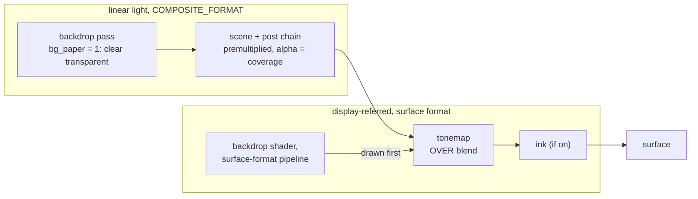

# 0257 — The backdrop reaches paper white

> **Status:** done - Phase 4 owed, ADR-0249. Phases 1-3 landed in `9e026bb7`, `acf290cb` and
> `2dc4be87`; conductor close round 1: no blockers, no majors, one minor (open), one nit (fixed in
> `a0e4eefe`). Version 0.175.0.
> **Created:** 2026-10-11
> **Owner skill(s):** dev, human
> **Related ADRs:** [ADR-0270](../../adrs/0270-a-paper-backdrop-is-painted-after-the-tonemap-and-the-scene-lies-over-it-by-coverage.md) (accepted), [ADR-0046](../../adrs/0046-linear-light-hdr-composite-bloom-tonemap.md), [ADR-0055](../../adrs/0055-backdrop-leaves-the-post-chain.md), [ADR-0201](../../adrs/0201-a-fullscreen-scene-presents-premultiplied-over-the-backdrop.md), [ADR-0096](../../adrs/0096-the-display-write-dithers.md)
> **Closes:** design-backlog 0287

## TL;DR

A new structural backdrop param, `bg_paper`, moves the backdrop out of linear light. At
`bg_paper = 1` the backdrop is painted at the surface format into the tonemap's output, and the
tonemap writes the scene over it with a premultiplied OVER blend, by the scene's own coverage. A
white palette stop at `bg_bright = 1` is display white, 255, and every pixel the scene covers is
byte-identical to the same scene over black. The first visible result is the voxel solid teaching
preset drawn black on true white with `exposure` back at 1.

## Context & problem

Backlog 0287, raised by the owner on the voxel teaching presets. The backdrop is painted in linear
light before the tonemap, whose shoulder tends to 1 and never reaches it, so `bg_bright = 1` reads
as a light grey (`0.800` linear). `docs/examples/voxel/solid.toml` reaches white with
`exposure = "3"`, which lifts the whole frame and works only because its cubes are near black.
`ink_amount = 1` was rendered and rejected because it flattens the lit shading. ADR-0270 has the
mechanism and the alternatives.

## Decision

ADR-0270: `bg_paper` (structural, 0 or 1, default 0). At 1:

- the backdrop pass clears the chain's destination to **transparent** and draws nothing;
- the same backdrop shader draws into the tonemap's **output** target at the surface format;
- the tonemap writes with a premultiplied OVER blend, so a pixel reads
  `tonemap(scene) + (1 - coverage) * paper`.

At 0 every pass, pipeline and write is the shipping one. We rejected widening `bg_bright` (still not
255, ground stays light), a tonemap white point (lifts the scene) and paper inside ink (flattens the
shading).

## Architecture diagram

## Implementation phases

### Phase 1 — Walking skeleton: one preset on true white
- **Owner skill:** dev
- **What:**
  - Add `bg_paper` to `background.rs`'s `PARAMS`: range `[0, 1]`, `ParamKind::Structural`,
    `ParamGroup::Post`, not `main`, read as on at `>= 0.5` like `bg_coord_mode`.
  - At `bg_paper = 1`, the backdrop pass clears its destination to `Color::TRANSPARENT` and draws no
    gradient.
  - A second backdrop pipeline at the surface format draws the backdrop into the display target
    (`composite.rs`'s `display`: ink's input, or the surface) before the tonemap resolves. It is
    built lazily on the first frame that needs it.
  - The tonemap gets an OVER pipeline variant (`One`, `OneMinusSrcAlpha`), chosen at `bg_paper = 1`.
    It writes the tonemapped premultiplied colour with the input's alpha. The `REPLACE` pipeline
    stays the one used at 0.
  - `docs/examples/voxel/solid.toml` sets `bg_paper = "1"` and drops `exposure`, and its header
    comment says why.
- **Files touched:** `core/src/render/background.rs`, `core/src/render/tonemap.rs`,
  `core/src/render/tonemap/tests.rs`, `core/src/render/composite.rs`, `core/tests/background_composite.rs`, `core/tests/fixtures/`, `docs/examples/voxel/solid.toml`, and the generated
  `presets/README.md`, `presets/schema/`, `presets/preset.schema.json`, `.taplo.toml`,
  `docs/specs/player-schema.json`.
- **Done when:**
  - `cargo nextest run -p rlx-core --test golden` passes with `RLX_BLESS` unset, so every shipping
    frame is byte-identical at `bg_paper = 0`.
  - A test renders a fixture whose palette ends at `#ffffff`, with `bg_paper = 1`,
    `bg_bright = 1`, `bg_hue = 1` and a scene that covers only the frame's middle. A corner pixel
    reads exactly `(255, 255, 255)`.
  - The same test renders the fixture again with `bg_paper = 0` and `bg_bright = 0`. Every pixel
    the scene fully covers is byte-identical between the two renders.
  - `docs/examples/voxel/solid.toml` contains no `exposure` key: `git grep -c exposure -- docs/examples/voxel/solid.toml`
    prints nothing and exits 1.

### Phase 2 — The dissolve and ink
- **Owner skill:** dev
- **What:**
  - A transition holds the outgoing side's paper state as it holds `outgoing_exposure`. The paper is
    drawn whenever either side is paper, from the incoming side's backdrop when both are, else from
    the side that has one.
  - The OVER tonemap is used whenever a paper is drawn this frame. A non-paper side's frame stays
    opaque, so the blended alpha moves from one side's coverage to the other's.
  - Ink is unchanged: it reads the tonemap's output, paper included.
- **Files touched:** `core/src/render/composite.rs`, `core/src/render/transition.rs`, `core/src/render/background.rs`, `core/tests/background_composite.rs`.
- **Done when:**
  - A dissolve from a paper fixture to a black-ground fixture is captured at `t = 0` and `t = 1`.
    The `t = 0` frame is byte-identical to the paper fixture alone. The `t = 1` frame is
    byte-identical to the black-ground fixture alone. The same holds in the other direction.
  - At `t = 0.5` in both directions, an uncovered pixel's value lies strictly between its values at
    the two ends.

### Phase 3 — Cost, the golden and the documentation
- **Owner skill:** dev
- **What:**
  - Bless one golden: the Phase 1 fixture at `bg_paper = 1`, on the software adapter.
  - Probe the frame time of the solid teaching preset at 1920x1080 with `bg_paper` on and off, in one
    run on one adapter (ADR-0074). Log both.
  - `docs/presets.md` documents `bg_paper` beside the other `bg_*` params. It names what paper is
    not: it does not bloom, fold, trail or move with `exposure`; additive light over it composites
    by coverage; a gradient on it is not dithered (ADR-0270, Negative).
  - `docs/how-it-works.md`'s pass list (the sentence ending "a terminal ink tone-remap") gains the
    paper route.
  - Regenerate `docs/images/voxel/solid.png` through `scripts/docs-shots.mjs`, which already shoots
    the teaching preset.
  - The log carries the text the preset-author skill's backdrop notes should gain, for the owner to
    apply in Phase 4: a headless session cannot edit `.claude/` (ADR-0210). <!-- claude-allow: Phase 3 only logs replacement text for the preset-author skill and writes no file under .claude/; Phase 4 applies it -->
- **Files touched:** `core/tests/golden.rs`, `core/tests/golden/`, `docs/presets.md`,
  `docs/how-it-works.md`, `docs/images/voxel/solid.png`, `presets/README.md`.
- **Done when:**
  - `cargo nextest run -p rlx-core --test golden` passes with `RLX_BLESS` unset.
  - The log carries both frame times. The paper frame costs no more than one extra fullscreen
    pass over the non-paper one, or the log names the difference.
  - `cargo nextest run -p rlx-core --test suite preset_schema::` and
    `cargo nextest run -p rlx-core --test suite preset::the_parameter_reference_block_is_current` pass with
    no update variable set.
  - `node scripts/check-doc-links.mjs` and `node scripts/toc.mjs --check` pass.

### Phase 4 — The owner's look and the skill text
- **Owner skill:** human
- **Blocks merge:** no
- **What:** Judge the solid teaching preset on white, live, against the `exposure = 3` version in
  git history. Apply the logged skill text to `.claude/skills/preset-author/`.
- **Files touched:** `.claude/skills/preset-author/`.
- **Done when:** The verdict is in this log, and the skill text is committed or declined.

## Risks & open questions

- **A scene whose alpha lies.** Paper exposes every scene's coverage for the first time; a scene
  that writes `alpha = 1` where it has drawn nothing will hide the paper there. The fullscreen and
  particle routes were measured to carry real coverage (ADR-0201, Plan 0091 Phase 1); one that does
  not is a scene bug to fix, and Phase 1's fixture is chosen from a scene known to be right.
- **Layer blends.** A `multiply` second layer (ADR-0090) over a transparent first layer has nothing
  to darken. Paper is under the whole chain, so multiply cannot darken it either. This is
  consistent with the backdrop today (backlog 0069's correction box) and is documented in Phase 3
  rather than solved.
- **Pipeline count on a software adapter.** ADR-0046's WARP sensitivity is unverified on lavapipe;
  both new pipelines are lazy, so no shipping capture builds them.

## What this plan does NOT do

- It does not change the tonemap curve, `KNEE` or the dither.
- It does not move ink or give ink a separate ground.
- It does not let `multiply` darken the paper.
- It does not author shipped presets on paper. That is `preset-author`'s, after the close.

## Implementation log

**Lane:** branch `plan-0257-the-backdrop-reaches-paper-white`, worktree `/home/igor/Work/rlx-plan-0257`

| phase | owner | state | commit |
|---|---|---|---|
| 1 — Walking skeleton: one preset on true white | dev | done | 9e026bb7 |
| 2 — The dissolve and ink | dev | done | acf290cb |
| 3 — Cost, the golden and the documentation | dev | done | 2dc4be87 |
| 4 — The owner's look and the skill text | human | owed | |

### Notes

- Phase 1: `bg_hue = 1` does not sample the last palette stop. The LUT sampler repeat-addresses
  `u`, so at exactly 1 it blends the last texel with the first, and a palette ending at `#ffffff`
  and starting at `#1e1e1e` gives a mid grey there (`Palette::sample` mirrors this). The fixture
  `core/tests/fixtures/backdrop_paper.toml` keeps `bg_hue = 1` and makes its palette flat white at
  both ends. `docs/examples/voxel/solid.toml` gains a `{ at = 0.98, #ffffff }` stop and moves
  `bg_hue` to `0.99`, inside the flat white segment, besides setting `bg_paper` and dropping
  `exposure` as the phase states.
- Phase 1: two files outside the phase's list were edited. `core/tests/suite/preset.rs` gains
  `bg_paper` in `declared_params_match_set_param`'s background roster and in its `Structural`
  roster; the test fails without both.
- Phase 1: the "covers only the frame's middle" fixture is the frozen solid voxel block. Fully
  covered pixels are found as those identical under a white and a 0.4 paper; the test asserts that
  mask is 10-90 % of the frame and excludes the corners.
- Phase 1: the golden suite passes with `RLX_BLESS` unset, but `backdrop_ramp` and `backdrop_band`
  read mean 0.0005, max outlier 20 and 21 (tolerance 48), not 0. Every other baseline reads 0.
  Building the linear backdrop pipeline before the queue writes, as the shipping code did, gives
  the same readings. A HEAD-only golden run was not possible in this session (no second worktree,
  no `git apply`), so whether the two readings predate this phase is not established.
- Phase 2: the blend shader wrote alpha 1.0 on every kind, which would hide a paper under the whole
  dissolve. It now writes the two sides' alpha moved by each kind's own per-pixel factor (`t` for
  the burn's, not its flare), and returns the outgoing alpha unchanged when the two are equal.
- Phase 2: `core/src/render/mod.rs`, outside the phase's list, now hands the outgoing
  `CompositeSide` to `encode_active_side` (`DisplayTail::outgoing`) whenever the incoming side is
  the live one: a freeze dissolve never evaluates the outgoing side otherwise, and its paper is
  painted from that side's `Background`.
- Phase 2: the dissolve test is `render::transition::paper_tests`, not in
  `core/tests/background_composite.rs`. A dissolve finalizes without drawing its `t = 1` frame, so
  the test sets `t` (and the kind, to `Crossfade`) on the running `Transition`, which only a test
  inside `render/` can reach.
- Phase 3 golden: `backdrop_paper` is `core/tests/fixtures/backdrop_paper.toml`, appended last to
  `EXTRA_FIXTURES`. The harness refuses `RLX_BLESS=<stem>` for a stem with no PNG, so it was
  written with `RLX_BLESS=1`; that run rewrote only `backdrop_ramp.png` and `backdrop_band.png`
  (the two drifting readings above), and both were put back with `git restore`. The unblessed
  re-run reads `backdrop_paper` mean 0.0000, max outlier 0.
- Phase 3 probe: `shot --presets <scratch dir> --report --size 1920x1080 --tier floor`, release,
  AMD Radeon Graphics (RADV RENOIR), Mesa 26.2.2, both twins of `docs/examples/voxel/solid.toml` in
  one run, differing only in `bg_paper`. ms a frame: `bg_paper = 1` **4.296**, `bg_paper = 0`
  **5.032**. The twins were not committed.
- Phase 3 docs: the `bg_*` params are documented in `presets/README.md`'s "Background pass", not in
  `docs/presets.md`, which names them only as a family. The full text is a new
  `#### Paper — bg_paper` there (after the band, before `occlude`). It covers the not-light list,
  coverage over additive light, no dither, `multiply`, ink, the dissolve cut, and the `bg_hue = 1`
  wrap seam. `docs/presets.md` gains one paragraph after its pass-order diagram that points to it.
- `docs/how-it-works.ru.md` translates `docs/how-it-works.md`, which gained a paragraph. Its
  stamp now lags; `node scripts/check-translations.mjs` reports that as advisory only.
- **For Phase 4**, the row `.claude/skills/preset-author/references/systems.md`'s
  `## Engine-wide stages (any system)` table should gain after the `bg_band_hue` row:

  > | `bg_paper` | `0` | **paper instead of light** (Plan 0257/ADR-0270). At `1` the frame starts transparent, the scene's light is tonemapped, and the same `bg_*` backdrop is painted *under* that picture at display values, laid over by the scene's coverage. A `#ffffff` stop at `bg_bright = 1` is display white (the light route stops at a light grey) and a fully covered pixel is exactly what it is over black, so **never lift the ground with `exposure`** — that lifts the figure too. Paper does not bloom, fold, trail or follow `exposure`; additive light over it reads as a coloured mark, not a brighter spot, so it suits an opaque figure (`present = "solid"`) far better than a glow; a paper gradient is not dithered; `multiply` and `ink` do not spare it. **`bg_hue = 1` is the palette's wrap seam** and blends the last stop with the first: end the palette on a flat white run (`0.98` and `1.0`) and aim `bg_hue` inside it (`0.99`), with `bg_shade` = `bg_shade_end` = `1`. Two paper presets cut their grounds at a dissolve. |

### Close triggers

- **`presets/` touched:** yes, no `.toml` in it. `presets/README.md` (the generated parameter block
  gains `bg_paper`; a hand-written `#### Paper — bg_paper` section), and the generated
  `presets/preset.schema.json` and every `presets/schema/*.schema.json`.
- **`Closes:`** design-backlog 0287.
- **What shipped:** a feature: the structural backdrop param `bg_paper`, its paper pipeline, the
  tonemap's OVER write and the dissolve's coverage blend.
- **Operator docs moved:** `docs/presets.md`, `docs/how-it-works.md`, `presets/README.md`,
  `docs/specs/player-schema.json` (generated), `docs/examples/voxel/solid.toml`,
  `docs/images/voxel/solid.png`.
- **`node scripts/check-backlog-claims.mjs`:** exit 0; 46 reductions across 22 live entries, 3
  unprobeable; 31 advisory moved paths, none naming 0287.
- **`human` phases remaining:** Phase 4 (`Blocks merge: no`): the owner's live look and the skill
  text quoted in the notes above.
- **Full suite:** owed to the conductor's pre-review gate (ADR-0207).

## Close review

Conductor close, round 1, 2026-10-11. No earlier round raised a finding, so there are no fix-round
rows. Phase 4 is owed (ADR-0249): nobody has yet judged the solid teaching preset on white live
against its `exposure = 3` version, and the preset-author skill does not yet carry the `bg_paper`
row quoted in the log. The minor below is test logic and stays open; the nit was repaired at the
close in `a0e4eefe`. Upstream CI on `origin/main` read green before the merge (run 38132564345 at
`da03dfa`). Translation advisory: `docs/how-it-works.ru.md` now lags its English source by the paper
route paragraph.

The round 1 review, in full:

### Plan 0257 — close review, round 1

Graded at tip `a63c6a3185d0f5e398633564cf0d575ab9b795fe` (tree `b5303904`), lane
`/home/igor/Work/rlx-plan-0257`, branch `plan-0257-the-backdrop-reaches-paper-white`.

**Verdict: Plan 0257 landed cleanly. No blockers, no majors, one minor, one nit.** `bg_paper` does
what ADR-0270 decided, through the passes it named. At `bg_paper = 0` every shipping path is the
one on `main`, and the goldens prove it.

#### Evidence

- **Full suite.** `node .../with-lock.mjs suite -- cargo nextest run --workspace` printed
  `with-lock: skipped cargo nextest run --workspace: tree b530390 is green in the suite ledger, run by
  gate 0257-pre-review at 2026-10-11T12:44:49.921Z: 2089 tests run: 2089 passed (11 slow), 9 skipped`.
  `b530390` is the tip's tree (`git rev-parse HEAD^{tree}` = `b5303904`), so that ledger record is
  the full-suite evidence for this tip.
- **`RUSTDOCFLAGS="-D warnings" cargo doc --workspace --no-deps`:** clean.
- **Golden, re-run with output** (`cargo nextest run -p rlx-core --test golden --no-capture`, under
  the suite lock): every baseline reads mean 0.0000 and max outlier 0. The exceptions are
  `backdrop_ramp` (mean 0.0005, outlier 20) and `backdrop_band` (mean 0.0005, outlier 21), both
  within tolerance. `backdrop_paper` reads 0.0000 / 0.
- **The open question in the log is settled: that drift predates this plan.** The implementer could
  not tell whether the two backdrop readings came from Phase 1. I put `main`'s versions of all nine
  changed render and test files into the lane (`git restore --source=main -- …`) and re-ran the same
  golden suite. It printed the identical readings: `backdrop_ramp` 0.0005 / 20 and `backdrop_band`
  0.0005 / 21, with every other baseline at 0. I then restored the files from `HEAD`, and
  `git status --porcelain` is empty. So Phase 1's "every shipping frame is byte-identical at
  `bg_paper = 0`" holds against `main`. The two readings are a pre-existing difference between the
  committed PNGs and this machine's lavapipe, and they should not be blamed on 0257.
- **Phase 1's done-when `git grep -c exposure -- docs/examples/voxel/solid.toml`** printed nothing and
  exited 1, as required. I ran it as written, a single command.
- **Doc gates:** `node scripts/check-doc-links.mjs` OK, `node scripts/toc.mjs --check` OK,
  `node scripts/check-comment-hygiene.mjs` OK, `node scripts/check-reader-prose.mjs` OK (every
  citation in the new `presets/README.md`, `docs/presets.md` and `docs/how-it-works.md` text is
  inside a link).
- **`node scripts/check-backlog-claims.mjs`:** exit 0, 46 reductions across 22 live entries, 3
  unprobeable. No advisory row names 0287, which is already in the archive (promoted at approval).
- `docs/images/voxel/solid.png` opened: near-black voxel foam on a pure white page.

#### Lens 1 — alignment

- Every phase carries one in-vocabulary owner tag (`dev`, `dev`, `dev`, `human`). Phase 4 is
  `Blocks merge: no`, no phase reads its output, and the log row reads `owed`. That is correct
  under ADR-0249.
- **Phase 1.** `bg_paper` is declared in `background.rs` `PARAMS` as `Structural`, in the `Post`
  group, not `main`, with range `[0, 1]`, and it is read at `>= 0.5`.
  - `Background::render` clears transparent at paper (`background.rs:1186`).
  - `render_paper` draws the same shader through a second pipeline. That pipeline is built lazily,
    keyed by format.
  - `Tonemap::resolve(…, over_paper)` picks a lazily built `PREMULTIPLIED_ALPHA_BLENDING` pipeline
    and switches to `LoadOp::Load`. The `REPLACE` path and its clear are untouched at 0.
  - `a_paper_reaches_white_and_leaves_covered_pixels_unchanged` (`core/tests/background_composite.rs`)
    asserts all four corners are exactly `[255, 255, 255]`. It derives the fully covered mask from
    white and 0.4 papers, requires that mask to cover 10–90 % of the frame and to exclude the
    corners, and asserts every masked pixel is byte-equal to the `bg_paper = 0, bg_bright = 0`
    render. That matches the done-when, and the vacuity guard is real.
  - `the_over_write_lays_the_scene_over_the_paper_by_coverage` (`tonemap/tests.rs`) additionally
    pins the empty, opaque and half-covered cases of the blend itself, with the dither on.
- **Phase 2.** `Transition` holds `outgoing_paper` beside `outgoing_exposure`.
  - `encode_active_side` paints the live side's paper, or else the outgoing side's, and the
    tonemap takes the OVER write whenever a paper is drawn.
  - The blend shader now carries coverage through `coverage(a, b, f)`, which returns `a` unchanged
    when the two sides are equal. Two opaque sides therefore stay exactly 1.0 and the
    `bg_paper = 0` dissolve is byte-identical to `main`'s literal `1.0`.
  - `a_dissolve_holds_the_paper_of_whichever_side_has_one` checks both directions: `t = 0` and
    `t = 1` byte-equal to each fixture alone, and the corner strictly between them at `t = 0.5`.
    That is the done-when.
  - The test lives in `render::transition::paper_tests` rather than `background_composite.rs`, and
    the log gives the reason (the `t = 1` frame is reachable only from inside `render/`).
- **Phase 3.** The `backdrop_paper` golden is appended last to `EXTRA_FIXTURES`. The log explains
  the bless procedure: the two drifting PNGs were rewritten and then restored, which is consistent
  with the readings above.
  - The cost probe found 4.296 ms with paper and 5.032 ms without, in one run on one adapter. The
    done-when ("no more than one extra fullscreen pass, or the log names the difference") is met.
  - The full `bg_paper` documentation went to `presets/README.md`, where the `bg_*` params are
    actually documented, with a pointer paragraph in `docs/presets.md`. The plan asked for
    `docs/presets.md`, the log records the deviation, and the reader gets the better result.
  - `docs/how-it-works.md` gains the paper route.
  - The replacement text for the skill is in the log, so Phase 4 can apply it.
- **Files touched outside the phase lists:** `core/tests/suite/preset.rs` (P1) and
  `core/src/render/mod.rs` (P2). Both are logged with reasons, and both edits are necessary.
- The log (~79 lines) is not longer than the phases section (~82 lines).

#### Lens 2 — layering and real-time safety

No audio-source or platform type is involved, and nothing escapes the wgpu layer. The new render
paths use `let … else { return }` with no `unwrap` or `expect`. Both new pipelines are built on
first use, so a frame without paper never creates them (the WARP pipeline-count risk is
unchanged). Neither the C ABI nor the control protocol is touched. `DisplayTail` gains one
`outgoing` field that is read for exactly one purpose.

#### Lens 3 — docs and bookkeeping owed at the close

- Plan to `done/`. Accept ADR-0270 (`proposed → accepted`) and update its index row. Re-point the
  links.
- Backlog 0287 is already in the archive: add the `CLOSED` marker and move the `### Promoted` row to
  `### Closed`.
- **Version bump: minor.** This is a feature: a new structural param, a pipeline and a blend.
- **Translation advisory:** `docs/how-it-works.ru.md` (stamped `2ad353bc`) now lags its English
  source by one paragraph, the paper route. Record that in one line of the close notes.
- **Curation (3b):** `presets/` was touched, but no `.toml` was. The generated parameter block,
  the schemas and the hand-written paper section changed, so there is nothing in the set to curate.
- **Phase 4 is owed**: the owner's live look, and the skill text quoted in the log for
  `.claude/skills/preset-author/references/systems.md`. The `Status:` line should read
  `done - Phase 4 owed, ADR-0249`.
- Outside this plan: `core/src/render/preview.rs:96` (`PreviewService::target`) warns `dead_code` in
  the test profile. That file is not in this plan's diff, so the warning arrived with `main`.

#### Lens 4 — correctness and determinism

- The tonemap's dither fades to zero at the black rail, which is why an empty (`rgb = 0, a = 0`)
  pixel adds exactly nothing over the paper. The OVER test pins this with the dither on.
- The OVER result's alpha is `a + (1 - a) * 1 = 1`, so the surface stays opaque.
- A paper's format is the tonemap's `target_format`, and that is also ink's input format. A
  format change rebuilds the paper pipeline.
- No numeric assertion is a frozen measurement:
  - the white and covered-pixel assertions are exact byte equalities;
  - the half-covered tolerance (±2 levels) is derived from the dither amplitude and rounding;
  - the 10–90 % coverage mask is a vacuity guard, not a threshold on noise.
- **The configuration nothing probes is the minor below:** both dissolve fixtures are voxel, and a
  same-system pair always runs `Mode::Freeze`, so the dual-live path is never exercised with a
  paper side.

#### Lens 5 — design integrity

The `Scene` trait is not widened. The backdrop gains a second destination, and the composite gains
the policy that picks between them. `Background` still owns its shader, LUTs and uniforms, and both
routes share `prepare`, so there is no duplicate upload path.

#### Findings

##### Minor

1. **The dual-live dissolve is never exercised with a paper side.**
   `core/src/render/transition.rs:1381`. `a_dissolve_holds_the_paper_of_whichever_side_has_one`
   builds both sides from the same voxel fixture. `pair_shares_resources` forces `Mode::Freeze` for
   a same-system pair, so the test never reaches the dual-live path, where the outgoing side is
   re-evaluated every frame and its own `Background::render` clears transparent into the blend's
   snapshot target. Reading the code, the path looks correct (`draw_frame` passes `Some(side)`
   whenever the incoming side is live, in either mode), but no test confirms it.
   - **Why it matters:** the governor picks dual-live for any cross-system pair with headroom,
     which is the common case in a real roster.
   - **Fix:** add a cross-system variant, for example a paper voxel side against a non-voxel
     black-ground fixture, driven through `begin_transition_forced(to, Mode::DualLive)`, with the
     same `t = 0` and `t = 1` byte assertions.
   - **Close:** open. A test is code, which a close does not write (ADR-0209).

##### Nit

1. **The module doc of `core/tests/background_composite.rs` now relies on nextest's process per
   test** (`core/tests/background_composite.rs:17`). The file used to hold exactly one test so that
   the hardware renderer never shared a process with a software device. It now holds a hardware test
   and a software test, and the doc says nextest keeps them apart. That is true under the canonical
   runner, but a plain `cargo test` runs both tests as threads of one process. Either name nextest
   as a requirement in that sentence, or move the paper test to its own file.
   - **Close:** fixed in `a0e4eefe` (the doc names nextest as a requirement).

## Followups (after this lands)
