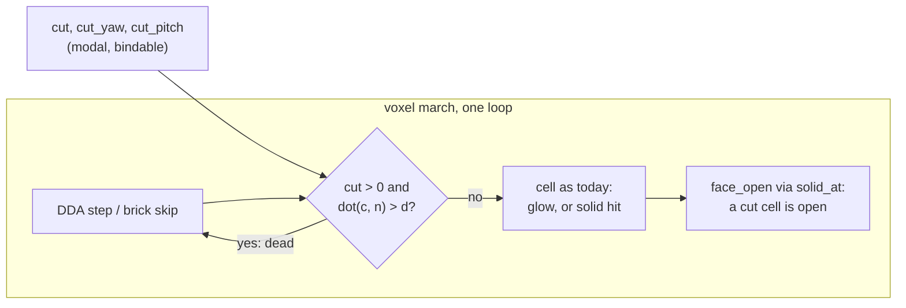

# 0258 — The voxel opens along a section plane

> **Status:** done. Phase 4: the owner judged the look live on 2026-10-11 and kept it; skill text in `c71f9780`. Phases 1-3 in `2ae1af1c`, `7b0c6a12`, `26e9e0b1`;
> conductor close round 1: no blockers, no majors, one minor (open). Version 0.174.0.
> **Created:** 2026-10-11
> **Owner skill(s):** dev, human
> **Related ADRs:** [ADR-0271](../../adrs/0271-a-voxel-is-opened-by-one-section-plane-held-in-the-cubes-own-frame.md) (accepted), [ADR-0268](../../adrs/0268-a-3d-automaton-is-a-voxel-system-marched-as-an-emitting-absorbing-volume.md), [ADR-0269](../../adrs/0269-a-solid-voxel-is-lit-by-one-key-light-and-its-own-occlusion-and-its-light-blooms-like-any-other.md), [ADR-0256](../../adrs/0256-a-parameter-declares-its-group-and-whether-it-is-main.md)
> **Closes:** design-backlog 0288

## TL;DR

`voxel` gains three modal params, `cut`, `cut_yaw` and `cut_pitch`, that hide every cell beyond one
plane held in the cube's own frame. The march, the solid present's occlusion and the brick skip all
treat a cut cell as dead, so a dense rule shows its inside as a stepped section of cubes. At
`cut = 0` nothing moves. The first visible result is a `crystal` mass cut in half, turning, with its
hollows lit.

## Context & problem

Backlog 0288, from the owner's Plan 0256 Phase 5 verdict: the solid present is a keep, and the
owner wants to see holes inside the structure. The march stops at the first live cell, so a dense
rule shows only its skin. The teaching preset switched to the porous `pyroclastic` rule, which
changes the content rather than the view. The glow present has the same wall: its dense rules fill
their ball. ADR-0271 records the shape and the rejected alternatives.

## Decision

ADR-0271: one section plane. A cell whose centre `c` (in the cube's `[-1, 1]^3` frame) satisfies
`dot(c, n) > sqrt(3) * (1 - 2 * cut)` is dead to every reader, where `n` is the unit normal given by
`cut_yaw` and `cut_pitch` in the cube's frame. At `cut = 0` the test is skipped through a `select`.
We rejected a camera depth peel (the opening moves as the camera orbits), a clip box (six params for
one look), a structural key (no animation) and a capped section (hides the hollowness).

## Architecture diagram

## Implementation phases

### Phase 1 — Walking skeleton: one plane through the march
- **Owner skill:** dev
- **What:**
  - Add `cut` (`[0, 1]`, default 0), `cut_yaw` (`[0, TAU]`, default 0) and `cut_pitch`
    (`[-PI/2, PI/2]`, default 0) to `voxel/mod.rs`'s `PARAMS`, `ParamKind::Modal`, one group for all
    three, with only `cut` declared `main` (ADR-0256).
  - Pack the plane as one `vec4` (`n.xyz`, `d`) into the march uniforms, with `cut = 0` packing a
    flag that skips the test.
  - In `shader.rs`, one `cut_away(cell)` function. The march reads a cut cell as state 0 in both
    presents, and `solid_at` returns 0 for a cut cell, so `face_open` treats it as open.
  - The brick skip stays correct without learning the plane: a brick is skipped only on its own
    empty flag, and a full brick behind the plane is marched cell by cell.
  - One fixture: a solid 16³ block, `present = "solid"`, `ao = 0` (so no corner reads across the plane), `cut = 0.5`, `cut_yaw = 0`,
    `cut_pitch = 0`.
- **Files touched:** `core/src/render/scenes/voxel/mod.rs`, `core/src/render/scenes/voxel/shader.rs`,
  `core/src/render/scenes/voxel/tests.rs`, `core/tests/fixtures/`, and the generated
  `presets/README.md`, `presets/schema/`, `presets/preset.schema.json`, `.taplo.toml`,
  `docs/specs/player-schema.json`.
- **Done when:**
  - `cargo nextest run -p rlx-core --test golden` passes with `RLX_BLESS` unset, so `voxel.png` and
    `voxel_solid_ao.png` are byte-identical at `cut = 0`.
  - On the fixture, a test renders `cut = 0` and `cut = 0.5` with the eye **inside** the cut
    plane (the plane through the cube's centre contains the eye), so the plane projects to a
    straight line through the frame's centre. On the side the normal points to, every pixel has
    alpha 0 at `cut = 0.5`. On the other side, every pixel is byte-identical to the `cut = 0`
    render, because no ray on that side enters a cut cell.
  - At `cut = 1` the frame is the backdrop alone: every pixel's alpha is 0.

### Phase 2 — The section is lit as a surface
- **Owner skill:** dev
- **What:**
  - A test fixture holds a solid block with `ao = 1`, cut through the middle at
    `cut_pitch = 0.6`, so the section steps.
  - Confirm that the section's cell faces take the entry-face normal and the key light like any
    face, and that AO does not darken a section face against the cut cells beside it.
- **Files touched:** `core/src/render/scenes/voxel/tests.rs`, `core/tests/fixtures/`, and
  `core/src/render/scenes/voxel/shader.rs` only if the test finds a defect.
- **Done when:**
  - On a flat stretch of the section, a face's edge and its centre read the same value with
    `ao = 1`: no cut neighbour closes a corner.
  - The section's faces are interior to the block. At a pixel on the section, the `cut = 0` render
    reads the block's outer face, so the two renders differ there.

### Phase 3 — Cost, the golden, the teaching preset and the docs
- **Owner skill:** dev
- **What:**
  - Probe frame time on Plan 0255's three cost fixtures at `cut = 0` and `cut = 0.5`, same adapter,
    resolution and run (ADR-0074).
  - Bless one golden: the Phase 2 fixture at 32³, on the software adapter.
  - A second solid teaching preset, `docs/examples/voxel/section.toml`, runs a dense rule
    (`crystal` or `clouds`) with `cut` swept by an expression, and joins `scripts/docs-shots.mjs`
    as `docs/images/voxel/section.png`. It joins the `sanity`, `animation`, `reactivity` and
    `distinctness` rosters the way the solid teaching preset did in Plan 0256 Phase 3.
  - `docs/presets.md`'s `voxel` section documents the three params, that the cut turns with the
    structure and not the camera, and that the section is stepped at cell size.
  - The log carries the text for the preset-author skill's `## voxel` section, for Phase 4 (ADR-0210). <!-- claude-allow: Phase 3 only logs replacement text for the preset-author skill and writes no file under .claude/; Phase 4 applies it -->
- **Files touched:** `core/tests/golden.rs`, `core/tests/golden/`, `core/tests/fixtures/`,
  `core/tests/sanity.rs`, `core/tests/animation.rs`, `core/tests/reactivity.rs`,
  `core/tests/distinctness.rs`, `docs/examples/voxel/section.toml`, `scripts/docs-shots.mjs`,
  `docs/images/voxel/section.png`, `docs/presets.md`, `presets/README.md`.
- **Done when:**
  - The log carries each fixture's frame time at both `cut` values. Any fixture where the cut run
    is slower than the uncut one is named with both times.
  - `cargo nextest run -p rlx-core --test golden` passes with `RLX_BLESS` unset.
  - The four gates pass with the section preset in their rosters.
  - `cargo nextest run -p rlx-core --test suite preset_schema::` passes with no update variable set.
  - `node scripts/check-doc-links.mjs` and `node scripts/toc.mjs --check` pass.

### Phase 4 — The owner's look and the skill text
- **Owner skill:** human
- **Blocks merge:** no
- **What:** Judge the section preset live. Apply the logged skill text to
  `.claude/skills/preset-author/`.
- **Files touched:** `.claude/skills/preset-author/`.
- **Done when:** The verdict is in this log, and the skill text is committed or declined.

## Risks & open questions

- **The brick skip is the cost risk.** A cut through a sparse field marches cut bricks cell by
  cell. If Phase 3's probe shows a named fixture slower than NFR section 1 on `Floor`, the follow-up
  is to fold the plane into the brick test (skip a brick wholly beyond the plane), which is a
  bounded change; it is not pre-built here.
- **The cut is in the cube's frame, and the camera orbits.** A sweep bound to `time` and an orbit
  bound to `time` can alias into a section that seems still. That is authoring, and the teaching
  preset is where it is shown.
- **The automaton keeps running under the cut.** Cells beyond the plane still live and still seed
  their neighbours. Only the view is cut, which is the point, and `docs/presets.md` says so.

## What this plan does NOT do

- It does not add a second plane, a box or a depth peel.
- It does not cap the section with a flat colour.
- It does not change the rules, the march's step or the lighting model.
- It does not retune `docs/examples/voxel/solid.toml`, which keeps `pyroclastic`.

## Implementation log

**Lane:** branch `plan-0258-the-voxel-opens-along-a-section-plane`, worktree `/home/igor/Work/rlx-plan-0258`

| phase | owner | state | commit |
|---|---|---|---|
| 1 — Walking skeleton: one plane through the march | dev | done | 2ae1af1c |
| 2 — The section is lit as a surface | dev | done | 7b0c6a12 |
| 3 — Cost, the golden, the teaching preset and the docs | dev | done | 26e9e0b1 |
| 4 — The owner's look and the skill text | human | done | c71f9780 |

### Notes

- Phase 1: the plane's on/off flag rides in the unused `lit.w`, beside the new `cut` vec4.
  The fixture is `core/tests/fixtures/voxel_section.toml` (camera `yaw = pi/2`, so the eye
  lies in the plane). The probe's target is cleared transparent for this test, so "alpha
  0" reads the volume's own coverage; the existing probes still clear opaque black.
  `.taplo.toml` did not change on regeneration.
- Phase 2: the fixture is `core/tests/fixtures/voxel_section_lit.toml`, already at 32³, so
  Phase 3's golden reads the same file. The test's tread is chosen on the block's `+x` side,
  where a cut neighbour wrongly read as solid would close the corners unevenly; with
  `|| cut_away(c)` removed from `solid_at` it fails (edge 0.238 against centre 0.194).
  `shader.rs` was not changed.
- Phase 3 cost probe: `shot --report family=voxel`, release, 1920x1080, AMD Radeon Graphics
  (RADV RENOIR), the three cost fixtures and a `cut = 0.5` twin of each (`cut_yaw = cut_pitch =
  0`) loaded as one library, so all six are timed in one run. ms a frame, uncut / cut:
  - `Floor` (64³): sparse 6.462 / 6.390, cloudy 12.321 / 9.778, worst 13.110 / 10.112.
  - `Rich` (128³), as information: sparse 13.632 / 13.233, cloudy 26.388 / 21.126, worst
    27.640 / 21.864.
  - No fixture is slower cut than uncut on either tier.
- Phase 3 golden: `RLX_BLESS=voxel_section_lit` is refused for a baseline with no PNG yet, so
  it was blessed with `RLX_BLESS=1` filtered to `scenes_match_golden_baselines`. That
  re-encoded `backdrop_band.png` and `backdrop_ramp.png`, which were restored; only
  `voxel_section_lit.png` is new.
- Phase 3 teaching preset: `crystal` runs from `seed_radius = 0.8`, not the rule's own 0.2, at
  `distance = 3.4` with `key = 0.2 + 2.2 * bass`. At 0.2 / 4.2 / `0.6 + 1.4 * bass` the
  reactivity gate read bass 0.0097 against its 0.02 floor; as committed it reads bass 0.0391,
  onset 0.0279. Sanity coverage 0.2814; animation passes on the silent branch (0.1202).
- Phase 3 distinctness: the voxel teaching-preset report now prints every pair of three. The
  section preset is no near-duplicate (shape 0.159 against clouds, 0.166 against solid); the
  report still prints the existing `Voxel Clouds ~ Voxel Solid` near-dup (shape 0.077).
- Phase 3: `docs/presets.md` embeds `docs/images/voxel/section.png` in the new subsection, the
  first image in that page. `presets/README.md` was not touched in Phase 3; its generated rows
  moved in Phase 1.
- Phase 4 skill text, for the end of the **Solid.** paragraph of `## voxel` in
  `.claude/skills/preset-author/references/systems.md` (ADR-0210):

  > **The section plane.** `cut` (0-1) hides every cell beyond one plane so a dense rule shows
  > its inside: 0.5 cuts through the centre, 0 is off, 1 hides all. `cut_yaw` / `cut_pitch` turn
  > the plane in the **cube's** frame (at `0, 0` the hidden side is `+z`), so it turns with the
  > structure, not the camera, and an orbit swings the cut face past the viewer once a turn.
  > Sweep it slowly (`0.5 + 0.12 * sin(time * 0.4)`) at a rate unlike the orbit's, or the two can
  > line up into a section that seems still. The section is stepped at cell size, so author at
  > `grid = 64`. It pays off on a dense rule (`crystal`, `clouds`, `amoeba`); on an open one like
  > `pyroclastic` the holes already show. Only the view is cut: the automaton keeps growing
  > across the plane. The teaching preset is `docs/examples/voxel/section.toml`.

### Close triggers

- **`presets/` touched:** yes, generated files only, in Phase 1: `presets/README.md` (the
  params block), `presets/preset.schema.json`, `presets/schema/voxel.schema.json`. No preset
  file.
- **Plan header `Closes:`** design-backlog 0288.
- **What shipped:** feature.
- **Operator docs touched:** `docs/presets.md` (the `voxel` table's new "Cutting the cube open"
  subsection), `presets/README.md` params block (regenerated), `presets/schema/` (regenerated;
  `.taplo.toml` unchanged), `docs/specs/player-schema.json` (regenerated),
  `scripts/docs-shots.mjs` + `docs/images/voxel/section.png`.
- **Backlog probes (`node scripts/check-backlog-claims.mjs`):** exit 0; 46 reductions across 22
  live entries hold, no entry named.
- **Full suite:** owed to the conductor's pre-review gate (ADR-0207). Run here at Phase 3:
  `cargo nextest run --workspace -P fast`, exit 0, 1995 passed, 106 skipped; the four gate
  binaries (`--test sanity --test animation --test reactivity --test distinctness`) whole, exit
  0, 90 passed, 3 skipped; `--test golden`, exit 0, 5 passed.
- **Outstanding `human` phases:** Phase 4 (the owner's look and the skill text; `Blocks merge:
  no`).

## Close review

Conductor close, round 1, graded at `478b0c1a`. No earlier round, so no finding was resolved by a
fix round. **Phase 4 is owed** (ADR-0249): nobody has yet judged the section preset live, and
`.claude/skills/preset-author/references/systems.md`'s `## voxel` section does not yet describe the
section plane; the replacement text is in the log above. The round 1 review, in full:

**Plan 0258 — close review, round 1**

Graded at tip `478b0c1a5e8b96563c9408874729e6f8c28abcdc` (tree `c6da4d11`), lane
`/home/igor/Work/rlx-plan-0258` on `plan-0258-the-voxel-opens-along-a-section-plane`.

**Verdict: Plan 0258 landed cleanly. No blockers, no majors, one minor.** All three `dev` phases do
what the plan says, the tests assert what the done-whens claim, and Phase 4 (`human`,
`Blocks merge: no`) is correctly logged `owed`.

### Evidence

- **Full suite:** `node .../with-lock.mjs suite -- cargo nextest run --workspace` printed
  `with-lock: skipped cargo nextest run --workspace: tree c6da4d1 is green in the suite ledger, run
  by gate 0258-pre-review at 2026-10-11T12:35:20.779Z: 2092 tests run: 2092 passed (10 slow), 9
  skipped`. `git rev-parse HEAD^{tree}` is `c6da4d1126480fcb0d3bbaae41ccb77b0c6131de`, so the ledger
  record covers this exact tree. The log's `Full suite:` bullet defers to the conductor's
  `pre-review` gate, which is correct in conductor mode.
- `RUSTDOCFLAGS="-D warnings" cargo doc --workspace --no-deps`: clean.
- `node scripts/check-doc-links.mjs`: OK. `node scripts/toc.mjs --check`: OK.
  `node scripts/check-reader-prose.mjs`: OK (docs/presets.md 34 citations, 0 bare).
  `node scripts/check-comment-hygiene.mjs`: OK.
- `node scripts/check-backlog-claims.mjs`: exit 0, 46 reductions across 22 live entries; advisory
  lists 31 moved paths and 3 unprobeable claims, none touched by this plan. Backlog 0288 is already
  in `docs/design-backlog-archive.md`'s `### Promoted` table (line 364), so the close owes step 3c.

### Lens 1 — alignment

- **Owner tags:** every phase carries one in-vocabulary tag (`dev`, `dev`, `dev`, `human`); Phase 4
  alone carries `Blocks merge: no`, and no later phase reads its output.
- **Phase 1** (`2ae1af1c`): `cut` / `cut_yaw` / `cut_pitch` are `ParamKind::Modal`, all in
  `ParamGroup::Shape`, only `cut` `main` (`core/src/render/scenes/voxel/mod.rs:353-383`). The plane
  is packed into a new `cut` vec4 with the on-flag in the formerly unused `lit.w`
  (`mod.rs:795-799`, `1591-1593`); `cut_plane` matches ADR-0271's formula with `CUBE_RADIUS =
  sqrt(3)`. In `shader.rs` one `cut_away` gates both the march's state read (`shader.rs:546`, before
  `glow_of`, so both presents) and `solid_at` (`shader.rs:362`), and the brick skip is untouched,
  as the plan specified. `the_section_plane_hides_one_side_and_leaves_the_other` asserts alpha 0
  on every normal-side pixel, bitwise equality (`f32::to_bits`) on every other pixel, a non-empty
  comparison on both halves (>100 covered each), and alpha 0 everywhere at `cut = 1`. The fixture
  puts the eye on `+x`, inside the plane `z = 0`, and the test derives the normal's side from a
  projected `+z` point rather than assuming it. Byte identity at `cut = 0` for the existing goldens
  rests on the golden test passing plus the shader's `cut_away` returning false under the flag;
  the arithmetic on the uncut path is unchanged, which is sufficient.
- **Phase 2** (`7b0c6a12`): `a_tilted_section_is_lit_as_a_surface_and_occluded_by_no_cut_cell`
  searches the CPU mirror of the plane for a tread with every in-grid front neighbour cut, then
  asserts edge and centre luminance within 1e-3 at `ao = 1`, equality with the `ao = 0` render,
  a match to the analytic `+z`-face colour, and that the uncut render differs at that pixel. The
  log records that removing `|| cut_away(c)` from `solid_at` fails it (0.238 against 0.194), so
  the test discriminates the defect it guards. No shader change was needed, as the plan allowed.
- **Phase 3** (`26e9e0b1`): cost probe logged for all three fixtures at both `cut` values on both
  tiers, none slower cut; golden `voxel_section_lit` appended at the end of `EXTRA_FIXTURES`
  (`core/tests/golden.rs:234`), and `RLX_BLESS` panics off lavapipe, so it was blessed on the
  software adapter. `docs/examples/voxel/section.toml` runs `crystal` with `cut` swept on `time`,
  joins `scripts/docs-shots.mjs`, and joins the sanity, animation, reactivity and distinctness
  rosters with real assertions (coverage/quadrants/blot, both motion floors, the reactivity floor;
  distinctness is a report, as for its two siblings). `docs/presets.md` "Cutting the cube open"
  documents the three params, the cube-frame turning, the cell-size stepping and that only the view
  is cut.
- **Implementation log:** present, not longer than the phases section.

### Lens 2 — layering and real-time safety

Core-only change inside one scene; no ABI, protocol or `Scene` trait widening, no new dependency,
no audio-path code. `cut_plane` sanitizes non-finite inputs through `finite_or` and clamps `cut` and
`cut_pitch`, so the per-frame path has no panic. `docs/specs/player-schema.json`,
`presets/schema/voxel.schema.json`, `presets/preset.schema.json` and the `presets/README.md` params
block were regenerated and are held by `preset_schema` in the green suite.

### Lens 3 — docs and bookkeeping owed by the close

- ADR-0271 is `proposed`: flip to `accepted` with `docs/adrs/README.md`.
- Plan to `done/` with `Status: done - Phase 4 owed, ADR-0249`; refresh `docs/plans/README.md`.
- Backlog 0288: `CLOSED` marker and move its row from `### Promoted` to `### Closed` (step 3c).
- **Version bump owed: minor** (a feature plan: three new params and a teaching preset).
- Preset curation (3b): `presets/` was touched by regeneration only; no preset file landed.
- `.claude/skills/preset-author/references/systems.md` `## voxel` does not yet describe the section
  plane. That sweep row is Phase 4's, owed by the owner; the replacement text is in the log, and I
  checked it against the tree (the `+z` default, the three rule names, the teaching preset path are
  all correct).

### Lens 4 — correctness

No grid-derived aspect; the plane is in the cube's `[-1, 1]^3` frame using `mp.eye.w` (the grid
size) for the cell centre, identical to the march's own centre formula. Numeric assertions in the
new tests are dimensionless or exact (bitwise equality, alpha 0, 1e-3 luminance agreement between
two reads of one frame), not frozen machine measurements. The configuration the tests do not probe
is the finding below.

### Lens 5 — design integrity

The cut lives entirely in the voxel scene; the brick-skip cost risk the plan named was measured and
did not materialize. Nothing to flag.

### Findings

#### minor

1. **The glow present under a cut is unprobed** — `core/src/render/scenes/voxel/tests.rs:610`.
   Both section tests and the golden draw `present = "solid"`; nothing renders `glow` at
   `cut > 0`, yet `docs/presets.md` and the module doc both state that `cut` works under `glow`.
   The shader routes both presents through one `select` before `glow_of` (`shader.rs:546`), so the
   risk is low, but a later change to the glow branch that reads `texel` directly would pass every
   gate. Fix: a probe that renders a dense `glow` fixture at `cut = 0` and `cut = 1` and asserts the
   latter is the backdrop alone (alpha 0 under a transparent clear), mirroring Phase 1's last
   done-when. Test logic, so a close cannot repair it; it stays open.

### Close notes

- Upstream CI (`node scripts/check-upstream-ci.mjs`): green, run 38132564345 on `main` at
  `da03dfa`.
- The merge of `main` was already up to date at the graded tip.
- Curation (3b): no preset `.toml` added or changed; nothing to curate.
- Backlog probes: exit 0, 46 reductions across 22 live entries; no entry touched by this plan.
- Translations: `docs/running.ru.md` is behind `docs/running.md` (stamped `fb237a6c`, source at
  `b25cd8cf10`); not moved by this plan.

## Followups (after this lands)
