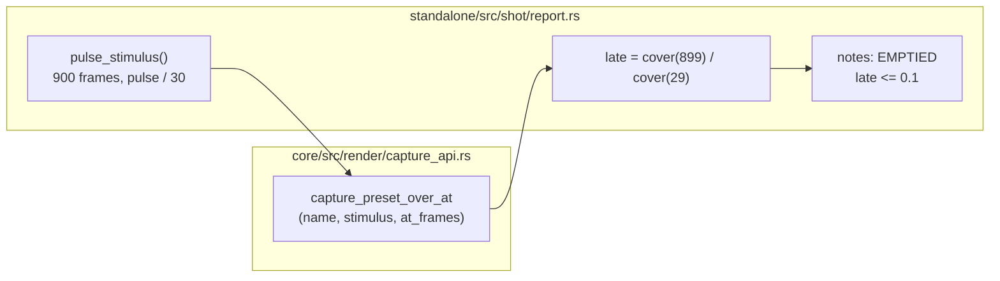

# 0261 — The report sees a world empty out

> **Status:** done - Phase 3 owed, ADR-0249 (2026-10-11). Phases 1-2 in `0d04da40`, `439411ec`; conductor close review round 1: no blockers, no majors, three minors (two fixed in `f1c8c50c`), one nit. Version 0.177.0.
> **Created:** 2026-10-11
> **Owner skill(s):** dev, human
> **Related ADRs:** [ADR-0099](../../adrs/0099-the-show-length-horizon-is-a-spot-check-and-it-splits-in-two.md), [ADR-0196](../../adrs/0196-the-report-hears-the-musical-clock-in-a-column-of-its-own.md)
> **Closes:** design-backlog 0294

## TL;DR

`shot --report` gains a `late` column. It is each preset's coverage after 15 seconds of a
music-like pulse, as a fraction of its coverage at half a second. A row whose `late` falls to a tenth
or less is flagged `EMPTIED` in the notes under the table. The first visible result is a sparse voxel
seed under `slow_decay`, which goes black today with every gate green, printing `EMPTIED` on the
first `--report` run against it.

## Context & problem

Backlog 0294. Authoring the voxel set, a sparse seed under `clouds` and `slow_decay` went black by
frame 300, and the author found it only by looking. Every instrument a preset passes measures its
first half second. The sanity suite captures 30 frames, the report's longest capture is 48, and
`--check` never runs the file. `shot --horizon` (ADR-0099) does measure minutes, but it is a manual
spot-check that the skill reserves for "worlds that accumulate", and it holds one `--set` for the
whole run. A held stimulus never re-fires an edge-triggered binding such as voxel's `reseed`, so a
horizon makes an onset-reseeded world look dead even when music keeps it alive.

So a world that empties out has no reading that runs by default, and the one long-run reading that
exists cannot tell "needs music" from "dies under music".

## Decision

Add one image-domain column to `--report`, for every system, measured under a pulsed stimulus rather
than a held one. Image-domain was the owner's choice over a voxel live-cell count (exact, but voxel
only and needing a new core readback) and over adding a suite gate (stronger, but it costs suite time
on every run). Like `count` and `drive`, the column is a reading, not a gate. The `EMPTIED` flag is
advisory and never changes the exit code.

The stimulus is 900 frames (15 s at the capture `dt`). Bands sit at a moderate level, and `onset`
and `beat` pulse for one frame every 30 frames (120 BPM), with the clock fields advancing as
`clock_stimulus` advances them. It is the cheapest sequence that keeps firing every edge a preset
can bind, so a world that empties out under it would empty out under music.

The capture reads back only two frames out of the 900. `capture_preset_at` holds one constant frame,
and `capture_preset_over` reads back every frame, so neither fits. Phase 1 adds the sibling that takes
a stimulus sequence and an index list.

## Architecture diagram

## Implementation phases

### Phase 1 — The capture primitive and the column
- **Owner skill:** dev
- **What:**
  - `Renderer::capture_preset_over_at(name, stimulus: &[AnalysisFrame], at_frames: &[usize])` in
    `capture_api.rs`. It advances one frame per stimulus entry from the same `reset_for_capture`
    seed as its siblings, and reads back only the listed indices, in `at_frames` order. It follows
    `capture_preset_at`'s rule for the readback buffer: built once, at the first requested frame.
  - `pulse_stimulus()` in `report.rs`, as described under Decision, with its constants named
    beside the existing `CLOCK_*` ones.
  - A `late` column. It reads `coverage(frame 899) / coverage(frame 29)` at `PROBE_SIZE`, each
    coverage taken against the frame-29 capture's own `modal_ground` with `COVERAGE_EPS`. A frame-29
    coverage of zero prints `-`. The JSON output carries the same field.
  - The notes block under each family table lists every row with `late <= 0.1` as
    `EMPTIED <preset> late=<value>`.
- **Files touched:** `core/src/render/capture_api.rs`, `core/tests/suite/capture_advance.rs`,
  `standalone/src/shot/report.rs`, `standalone/src/shot/report/tests.rs`,
  `standalone/src/shot/json.rs`.
- **Done when:**
  - A test in `capture_advance.rs` shows that `capture_preset_over_at(name, s, &[i])` is
    byte-identical to element `i` of `capture_preset_over(name, s)` for three indices, one of them
    the last.
  - A report test runs two inline voxel fixtures. One has a sparse seed under `slow_decay` and binds
    no `reseed`. The other is the same file with `reseed = "onset"`. The first is listed `EMPTIED`
    and the second is not.
  - The implementation log carries the `late` value of every shipped voxel preset, from
    `cargo run --release -p standalone --example shot -- --report family=voxel`.
  - The log carries the wall time of a whole-library `--report` before and after the change, on one
    adapter in one sitting.

### Phase 2 — The documentation and the skill text
- **Owner skill:** dev
- **What:**
  - `docs/capturing.md`, "What the report's columns mean", gains a `late` row in the table and a
    `#### The late column` section. The section covers the stimulus, the ratio, the tenth, and the
    two things the column cannot see. Coverage can hold while a world collapses into one bright
    blob, which is `--horizon`'s concentration reading. And a world can legitimately fade by design.
  - The "horizon" section of `docs/capturing.md` states that a held `--set` never re-fires an
    edge-triggered binding. Its example is voxel's `reseed`.
  - The `--report [family=<sys>]` row of the flag table lists every system the registry carries.
    It currently omits `voxel` and `waterfall`.
  - The log carries replacement text for the preset-author skill's `references/render-loop.md` for
    Phase 3 to apply, because a headless session cannot edit `.claude/` (ADR-0210). <!-- claude-allow: Phase 2 only logs replacement text for the preset-author skill and writes no file under .claude/; Phase 3 applies it -->
    The text covers two things. The horizon's trigger list ("run it when the mechanism has an
    accumulation axis") gains the cellular automata (`cellular`, `voxel`). And the report-reading
    section gains `late` and `EMPTIED`.
- **Files touched:** `docs/capturing.md`.
- **Done when:**
  - `git grep -c "EMPTIED" -- docs/capturing.md` prints a count of at least 1.
  - `git grep -n "family=<sys>" -- docs/capturing.md` shows a row naming both `voxel` and
    `waterfall`.
  - `node scripts/check-doc-links.mjs` and `node scripts/toc.mjs --check` pass.
  - The log carries the skill text.

### Phase 3 — The skill text
- **Owner skill:** human
- **Blocks merge:** no
- **What:** Apply the logged text to `.claude/skills/preset-author/references/render-loop.md`, or
  decline it.
- **Files touched:** `.claude/skills/preset-author/references/render-loop.md`.
- **Done when:** The text is committed or declined, and this log says which.

## Risks & open questions

- **The tenth is a choice, not a derivation.** It flags a world that has lost almost all of its
  light, which is what dying out looks like in this domain. A world that fades slowly by design will
  read low without being broken. That is why the flag is advisory and lives in the notes block, as
  `count`'s reading does.
- **Coverage is a proxy.** A world can keep its coverage while it dies, for example as a static
  residue that no longer moves. `anim` and `rate` already read motion, and `--horizon` reads the long
  run. This column answers "did it empty", not "is it alive".
- **Cost.** 900 frames at 96x96 per preset is the largest single capture the report takes. The
  horizon's measured rate (about 3,600 renders a simulated minute in 16 s at 96x96) puts it near 4 s
  per preset for a single-pass world. On a whole-library report that is minutes. Phase 1 logs the
  real figure. If it is unacceptable, the next lever is `family=`, which already exists, not a
  shorter stimulus, because shortening it gives back the half-second blind spot.

## What this plan does NOT do

- It does not add a suite gate. That was the third option, and the owner did not take it.
- It does not read voxel cells. The column is image-domain for every system.
- It does not change `--horizon` or its held stimulus.
- It does not retune any shipped preset that the column flags. That is the content lane's call, and
  Phase 1 only logs the voxel readings.

## Implementation log

**Lane:** `plan-0261-the-report-sees-a-world-empty-out`, worktree `/home/igor/Work/rlx-plan-0261`

| phase | owner | state | commit |
|---|---|---|---|
| 1 — The capture primitive and the column | dev | done | 0d04da40 |
| 2 — The documentation and the skill text | dev | done | 439411ec |
| 3 — The skill text | human | owed | |

### Notes

- **Phase 1, the fixture.** The bare fixture is `grid = 32`, `rules = ["slow_decay"]`,
  `seed_radius = 0.5`, `seed_fill = 0.45`, `step_rate = "8"`, no `reseed`. At `seed_fill` 0.05,
  0.1, 0.2, 0.3, 0.35 and 0.4 (radius 0.5), and at radius 0.25 fill 0.3, the same seed read `late`
  0.734, 0.386, 0.395, 0.163, 0.147, 0.124 and 0.197 on the release CLI and was not listed
  `EMPTIED`: `slow_decay` survives a cell with one live neighbour, and the 0.1-fill frame 900
  (`shot --frames 900`) shows a residue of isolated pairs, not a black cube. The 0.45 fixture read
  0.070 there, and the test finds its reseeded twin not `EMPTIED` on the software adapter (the
  0.1-fill reseeded twin read 1.796 on the CLI). So the TL;DR's "goes black" was not reproduced for
  a sparse fill; a fill just under the rule's own 0.5 empties to under a tenth.
- **Phase 1, layout.** `late` prints as a one-column block under the frame-cost block, not as a
  column of the main table, which sits at 99 of the 100 columns
  `no_report_table_line_wraps_at_a_hundred_columns` holds. That test and
  `two_names_sharing_their_first_fourteen_characters_print_as_distinct_rows` now count one more
  table. The JSON omits the `late` key where the text cell prints `-`, as `in_frame_geometry` does.
- **Phase 1, the stimulus.** Frame 0 is a pulse (`beat_index` 0, the analyzer's first-detection
  numbering), unlike `clock_stimulus`, so frames 29 and 899 sit at one phase after a pulse; `bpm`
  is set to 120.
- **Phase 1, the voxel readings**, release profile, RADV Renoir, from
  `cargo run --release -p standalone --example shot -- --presets presets --report family=voxel`.
  `--presets presets` was added to the plan's command: without it this box resolves the per-user
  library, which holds no voxel preset. `late`: Voxel Ember 3.166, Voxel Ice 2.861, Voxel Nebula
  1.494, Voxel Neon 1.968, Voxel Section 1.960, Voxel Solid 1.887, Voxel Solid Dark 1.923. No
  shipped preset in the whole-library run below is listed `EMPTIED`, and none prints `-`.
- **Phase 1, wall time** of `cargo run --release -p standalone --example shot -- --presets presets
  --report` (101 presets), timed by a scratch Node wrapper, same box, same sitting: **234.2 s**
  before, **441.8 s** after. Other lanes' suite runs shared the machine during this session and
  were not controlled for.
- **Phase 2, beyond the listed bullets** in `docs/capturing.md`: the "Three more labeled blocks"
  paragraph now counts four and names `late`; "Every one of those but `count`" now also excepts
  `late`; the frame-cost section's "This pass is the report's most expensive" now names `late` as
  the other. The `#### The late column` section carries the Phase 1 wall times.
- **Phase 2, the skill text** for Phase 3, for the preset-author skill's
  `references/render-loop.md`. (1) In "The horizon", replace the paragraph that opens **Run it when
  the mechanism has an accumulation axis** with:

  > **Run it when the mechanism has an accumulation axis** — trails / `fade`, a `[feedback]` table,
  > particles in a flow field, reaction-diffusion, a cellular automaton (`cellular`, `voxel`).
  > Anything where this frame's output is next frame's input. A look with none of those has nothing
  > for the horizon to find, and it costs minutes.

  and after the paragraph that opens **The stimulus is `--set`, held for the whole run**, add:

  > **A held stimulus never re-fires an edge-triggered binding.** `reseed = "onset"` under
  > `--set onset=1` refills once, on the first frame, and never again, so a horizon shows an
  > onset-reseeded world emptying even where music would keep it alive. The report's `late` column
  > asks that question under a pulse that keeps firing.

  (2) In "Reading the report", in "(the line families' `geom`, then the cost, lit-footprint, ...)"
  insert `late` after the cost, and add this row, joined into one line, to the column table above
  the `NEAR-DUP` row:

  > | `late` | `cover` at frame 899 of a 15 s pulse (`onset` and `beat` every 30 frames) over `cover`
  > at frame 29, at 96x96, in a block of its own | at or under `0.1` the notes print
  > `EMPTIED <preset> late=<value>`: the world kept a tenth or less of its early light under
  > music-like input. Advisory — a fade by design reads the same, so look before retuning; and a
  > collapse that keeps its `cover` reads fine here, which is the horizon's `peak/mean`. |

### Close triggers

- **`presets/` touched:** no.
- **Plan header `Closes:`** design-backlog 0294.
- **What shipped:** feature (`Renderer::capture_preset_over_at`, the `shot --report` `late`
  reading and its `EMPTIED` notes).
- **Operator docs touched:** `docs/capturing.md`.
- **Backlog probes (`node scripts/check-backlog-claims.mjs`):** exit 0, no entry named.
- **Full suite:** owed to the conductor's pre-review gate (ADR-0207). Narrowed runs this session:
  `cargo nextest run -p rlx-core --test suite capture_advance` (7 passed) and
  `cargo nextest run -p standalone --lib shot::` (105 passed, 204 skipped), both exit 0.
- **Outstanding `human` phases:** Phase 3 (`Blocks merge: no`).

## Close review

Conductor close, 2026-10-11. Round 1 is the only round, so no earlier finding was resolved by a fix
round. Repaired at the close: minors 1 and 2 in `f1c8c50c`. Open: minor 3 (no repair asked) and nit 4
(code). **Phase 3 is owed** (ADR-0249): the preset-author skill's `render-loop.md` does not yet name
the cellular automata as horizon candidates, does not warn that a held stimulus never re-fires
`reseed`, and does not list `late` or `EMPTIED` in its report-reading table. The replacement text is
in the log above. The round's review follows in full.

### Plan 0261 — close review, round 1

Graded at `6de699bea287e245e565555867d832364f0a0c0c` on `plan-0261-the-report-sees-a-world-empty-out`.

**Verdict: Plan 0261 landed cleanly. No blockers, no majors, three minors, one nit.** Phases 1 and 2
are built as planned. Phase 3 is a `human` phase marked `Blocks merge: no`, and its row correctly
reads `owed`. All three minors are prose: two can be repaired at the close (a doc paragraph and a test
doc comment), and one is a log-length note.

#### Evidence

- **Full suite.** `node .../with-lock.mjs suite -- cargo nextest run --workspace` printed
  `with-lock: skipped cargo nextest run --workspace: tree 2bffd8a is green in the suite ledger, run by
  gate 0261-pre-review at 2026-10-11T17:59:38.253Z: 2110 tests run: 2110 passed (14 slow), 9 skipped`.
  That ledger record is the full-suite evidence (ADR-0207).
- `RUSTDOCFLAGS="-D warnings" cargo doc --workspace --no-deps`: clean.
- `node scripts/check-doc-links.mjs`: OK. `node scripts/toc.mjs --check`: OK.
  `node scripts/check-comment-hygiene.mjs`: OK. `node scripts/check-backlog-claims.mjs`: exit 0 (the
  advisory lists moved paths, none of them this plan's).
- Phase 2 done-whens, each run as one command:
  - `git grep -c "EMPTIED" -- docs/capturing.md` gives a count of at least 1.
  - `git grep -n "family=<sys>" -- docs/capturing.md` gives line 134, which names both `voxel` and
    `waterfall`.
- **The lane is behind `main` by six commits** (the Plan 0262 close, `v0.176.1`) that landed after the
  pre-review merge. They are not part of this grade. The close's `git merge main` takes them in.

#### Lens 1 — alignment

- **Phase 1.** `Renderer::capture_preset_over_at` (`core/src/render/capture_api.rs:364`) follows the
  plan exactly. It shares the `reset_for_capture` seed, renders through the largest requested index,
  builds the readback buffer once at the first requested frame, and returns the frames in
  `at_frames` order. An index past the stimulus is `CaptureReadback`.
  - **The core test** `a_sampled_sequence_frame_is_the_frame_the_full_sequence_returns`
    (`core/tests/suite/capture_advance.rs`) asserts byte-equality with `capture_preset_over` at
    indices 2, 9 and the last. It requests each index alone, so the readback buffer is built at a
    different point each time. It also has a non-vacuity check and checks order and the
    out-of-range error. This matches the done-when.
  - **The report test** `a_sparse_voxel_seed_empties_unless_an_onset_reseed_refills_it` runs the
    two inline fixtures through the real `late_reading` and `text_report`. It asserts that the bare
    fixture is listed `EMPTIED` and its `reseed = "onset"` twin is not. This matches the done-when.
  - **The other new tests** (the stimulus shape, the ratio and the tenth inclusive, the block, the
    notes and the JSON key omission) assert the behaviour, not existence.
  - **The logged readings.** The voxel `late` readings and the before/after whole-library wall times
    are in the log, as the done-whens require.
- **Two deviations, both logged with reasons, both accepted.**
  - `late` prints as a one-column block under the frame-cost block, not in the main table, which
    sits at 99 of the 100 columns the width test holds.
  - The voxel command needed `--presets presets`.
- **The plan's premise was not reproduced, and the log says so honestly.** A *sparse* `slow_decay`
  seed does not empty: fills from 0.05 to 0.4 read `late` from 0.124 to 0.734. Only fill 0.45
  (radius 0.5) fell under a tenth, at 0.070. The fixture is therefore near-dense, not sparse. Two
  prose sites still state the falsified claim (minors 1 and 2). The close should also record this
  on backlog 0294's archived body when it appends the `CLOSED` marker. That entry's
  "a sparse seed under `clouds` and `slow_decay` was black by frame 300" holds only for a seed
  near the rule's own fill.
- **Owner tags.** All three phases carry one in-vocabulary tag. `Blocks merge: no` is on the
  `human` phase only, and no later phase reads Phase 3's output.
- **Close triggers.** The `Full suite:` bullet defers to the pre-review gate, which is correct in
  conductor mode, and the ledger record above confirms it.

#### Lens 2 — layering and real-time safety

- **Layering.** Nothing in `core/` names an audio source or a platform. The new primitive is an
  rlib method, off the hot path, and documented as blocking. There is no C ABI change and no
  control-protocol change.
- **Hot path.** The capture never runs on the audio or render loop, so it adds no hot-path
  `unwrap`.

#### Lens 3 — docs and bookkeeping

- **Operator docs.** `docs/capturing.md` carries:
  - the `late` row in the columns table and a `#### The late column` section with both
    limitations;
  - the horizon's held-stimulus caveat;
  - the complete `family=` roster;
  - corrected counts ("Four more labeled blocks", the settled-measurement exceptions, the
    most-expensive pass).
- **Owed after the merge.** The preset-author skill's `render-loop.md` is Phase 3's, and its
  replacement text is in the log.
- **Version bump owed.** The level is **minor**: this is a feature plan (a new `shot --report`
  reading and a new public `Renderer` method).
- **Backlog 0294.** The close moves its row from `### Promoted` to `### Closed` and appends the
  `CLOSED` marker, with the falsified-premise note above.
- **Translations.** None of the five `.ru.md` sources were touched.
- **`presets/`** was not touched, so there is no curation sweep.

#### Lens 4 — correctness and determinism

- **Determinism.** The stimulus is a pure function of constants. Both read frames sit 29 frames
  after a pulse. Both coverages are taken against frame 29's modal ground.
- **The fixture threshold.** The `EMPTIED` fixture asserts a reading of 0.070 against a threshold of
  0.1, measured on the software adapter and on RADV.
  - **Why it is acceptable.** The voxel state is an integer cellular automaton, seeded from an
    integer hash on the GPU. The reading is therefore close to adapter-independent: a
    rasterization difference moves `cover` by pixels, not by 30 %.
  - **The risk that remains.** Fill 0.4 reads 0.124, so the fixture sits between two fills that
    straddle the threshold. That knife edge is what minor 2's comment should state, instead of the
    mechanism it currently claims.

#### Lens 5 — design integrity

- **Duplication.** `capture_preset_over_at` repeats `capture_preset_at`'s body almost line for line,
  about 45 lines, differing only in whether the frame is indexed or held (nit 4).
- **No seam widened.** `json_late` follows `json_transient`'s shape.

#### Findings

##### Minor

1. **`docs/capturing.md:1047`.** The section repeats the premise the log falsified. It says "A
   sparse voxel seed under `slow_decay` can lose almost all of its light inside 15 s", and at line
   1054 it calls the fixture "a sparse `slow_decay` seed".
   - **The log's evidence.** Fills from 0.05 to 0.4 held 0.12 to 0.73. Only fill 0.45, near the
     rule's own 0.5, emptied.
   - **Repair (prose; a close may do it).** Use "A `slow_decay` seed filled just under the rule's own
     density can lose almost all of its light inside 15 s", and "a near-dense `slow_decay` seed
     (fill 0.45) with no `reseed`".
   - **Fixed at the close in `f1c8c50c`.**
2. **`standalone/src/shot/report/tests.rs:1356`.** `SPARSE_DECAY`'s doc comment claims "a sparse
   voxel seed ... a few stable pairs at best, so it keeps well under a tenth". The log contradicts
   all of it:
   - the fill is 0.45, which is not sparse;
   - a sparse fill leaves pairs and reads well **above** a tenth;
   - the fixture reads 0.070, while fill 0.4 reads 0.124.

   **Repair (doc-comment text; a close may do it).** "A `slow_decay` seed at fill 0.45, just under
   the rule's own 0.5, at half its radius, binding no `reseed`. It reads `late` near 0.07, while
   fill 0.4 reads near 0.12 and sparser fills hold their pairs above a tenth, so the fixture's
   margin under the tenth is narrow." **Fixed at the close in `f1c8c50c`.**
3. **`docs/plans/0261-the-report-sees-a-world-empty-out.md:148`.** The `## Implementation log`
   (about 82 lines) is longer than the plan's own `## Implementation phases` (about 63 lines). The
   bulk is Phase 3's replacement skill text, which has nowhere else to live under ADR-0210. No
   repair is needed beyond noting it. **Open.**

##### Nit

4. **`core/src/render/capture_api.rs:364`.** `capture_preset_over_at` duplicates
   `capture_preset_at`'s loop, its readback-on-first-request rule and its reorder.
   `capture_preset_at` could delegate through a per-index frame accessor, so the
   "built at the first requested frame" invariant lives in one place. This is code, so it stays
   open.

## Followups (after this lands)
